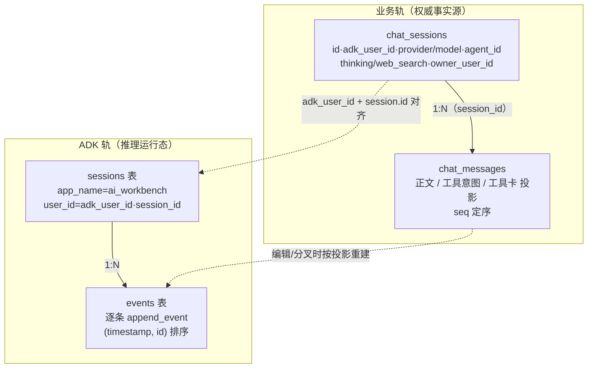
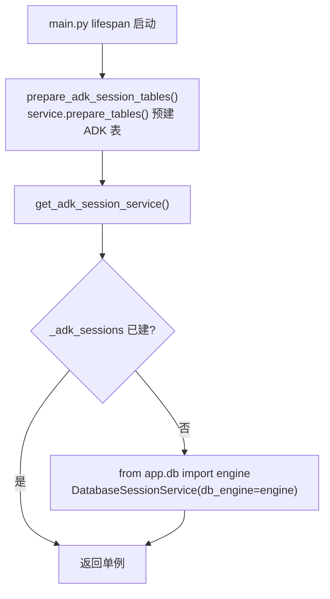
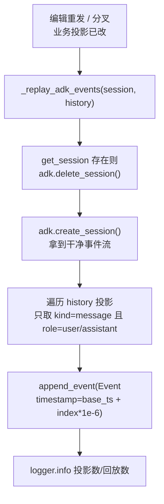
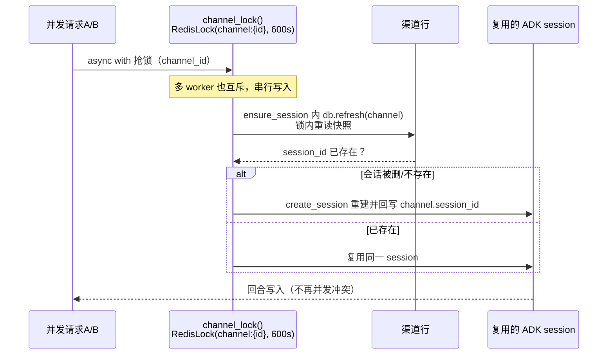

# ADK 会话与状态管理架构

一次对话的上下文由**两条独立的会话轨**共同承载：业务侧的 `chat_sessions` / `chat_messages` 负责前端可见的消息投影与元数据，ADK 侧的 `sessions` / `events` 表是 Runner 推理时的真实状态源。两轨靠 `adk_user_id + session.id` 对齐，业务侧是权威事实源，ADK 侧是随推理演进的运行态。本文讲两轨如何对齐、编辑重发/分叉时如何重建 ADK 事件、删除与并发防护，以及状态域的边界。消息落库与回放渲染见《对话与智能体架构》，对话帧分发见《Redis强依赖与多worker协同架构》。

## 双轨会话模型

- `ChatSession.adk_user_id`（`models/chat.py`）是两轨的连接键：业务会话 id 直接复用为 ADK `session_id`，`adk_user_id` 复用为 ADK `user_id`。发起回合时若 ADK session 不存在则按需创建（见《对话与智能体架构》的装配链路）。
- `ChatMessage` 是**投影到前端的消息**（role/kind/content/tool_call_json，含正文 / 工具意图 / 工具卡），消息全量落 `chat_messages`，是「消息发送不进审计」的前提。
- 关键认知：ADK events 才是模型真正看到的历史。业务投影被编辑/截断后，必须让 ADK 事件流跟上，否则模型会看到用户已删除的历史。

## SessionService 单例（adk_runtime/session_store.py）

进程内唯一一个 `DatabaseSessionService`，全平台所有 Runner、回放、删除都从 `get_adk_session_service()` 取同一实例。

- **复用业务库 engine**：若让 `DatabaseSessionService(db_url=...)` 自建引擎，会让连接池翻倍，且进程退出时无法随业务引擎一起释放。因此显式传 `db_engine=engine`，与业务库共用一套连接与生命周期。
- **启动时预建表**：`prepare_adk_session_tables()` 由 `main.py` lifespan 在 `yield` 前调用（与 vector_store、各 ensure_* 同级），确保 ADK 的 `sessions` / `events` 表在首回合前就绪；内部强制校验实例必须是 `DatabaseSessionService`（`InMemorySessionService` 会被 `TypeError` 拒绝）。
- 日志：创建单例、预建表完成均有 `logger.info`，可追溯是否走了复用 engine 的路径。

## 投影与回放（chat_service.py）

`_replay_adk_events()`（`:852`）是两轨一致性的收口：编辑重发、分叉之后都调用它，**先删旧 ADK session 再 create**，然后按业务投影逐条重建事件。

要点：

- **只回放正文**：工具调用没有完整的 wire 记录，无法逐条还原，回放时只重建 `user` / `assistant` 的 `message` 文本（跳过工具卡、thinking、system 等非 `message` 投影）。调用次数与落库数量会写日志（投影数 vs 回放数），便于排查上下文差异。
- **author 还原**：用户消息 author 为 `user`；assistant 消息用 `root_adk_name(agent_id or 'default')`，与装配时的根 Agent 名对齐，避免回放后模型认不出自己的历史。
- **Windows 时钟粒度坑（关键）**：回放是紧循环，Windows 系统时钟粒度约 **15.6ms**，连续 append 的事件会拿到相同 `timestamp`；ADK 按 `(timestamp, id)` 排序，而 `id` 是随机 UUID，历史顺序会被打乱。解法是显式给每条事件递增微秒：`base_ts = time.time()`，`timestamp = base_ts + index * 1e-6`，保证严格单调递增、顺序稳定。改动此处必须保留该递增逻辑。
- 两个触发点：编辑重发（`truncate_after_message` 删除目标消息及后续投影后，以剩余消息回放，`:997`）与分叉（`_fork_session` 以复制的前缀回放，`:845`）。

## 删除与分叉

**删除**（`delete_session()`，`:1121`）是硬删，同时清理两轨：

1. 显式删除该会话的 `Approval`（审批不随外键级联，必须手动清）；
2. `db.delete(session)` 提交——`chat_messages` 通过 `session_id` 外键的 `ondelete="CASCADE"` 级联删除；
3. 同步调用 `adk.delete_session(app_name, user_id, session_id)` 丢掉 ADK 会话，避免留下无人引用的运行态。
   `batch_delete_sessions()` 先整体校验存在再逐条删，任一 id 不存在则整批失败、已删 0 条。

**分叉**（`_fork_session`）只复制业务投影前缀：新建 `ChatSession`（`title + " (fork)"`，沿用 provider/model/agent_id/开关与页面上下文），按 `seq` 复制消息前缀（重生成 id、`seq` 重排），附件行按新 id 一并复制避免渲染引用旧会话被拒，产出物通过 `artifact_service.copy_for_prefix` 按 `message_id_map` 复制。**不复制 ADK 事件**——新会话的 ADK 事件流由末尾的 `_replay_adk_events()` 按前缀投影重建。

> 删除/分叉都改了两轨，后续任何「只改业务库、忘了同步 ADK 侧」的新路径都会造成幽灵会话或模型看到脏历史，务必对照本节核对。

## stale session 防护（发布渠道）

对外发布渠道复用同一个 ADK 会话，多个并发回合同时写入会撞 ADK 的 **stale session**（乐观并发冲突）。`publish_service.py` 用 Redis 分布式锁把同一渠道的回合跨 worker 串行化：

- `channel_lock()`（`publish_service.py:35`，注释在 `:31-36`）取 `RedisLock(f"channel:{channel_id}", ttl_ms=600_000)`；锁实现见《Redis强依赖与多worker协同架构》。此前用进程内 `Lock`，仅单进程有效，多 worker 失效。
- **锁内重读快照**（`ensure_session()`，`:310-339`）：并发请求在等锁之前拿到的 `channel` 可能是旧快照（另一请求刚建好会话），锁内先 `db.refresh(channel)` 再判断，否则会重复建会话并覆盖 `session_id`。`api/publish.py:446` 也有同款「串行化，避免并发写入撞 ADK stale session」注释。
- 过期待批由 `expire_stale_pending()`（`approval_service.py:168`）处理：把超时未决的 `pending` 审批标为 `expired`，**绝不自动批准**（与《工具执行权限与审批规则》的 SLA 口径一致）。渠道锁细节见《发布渠道架构》。

## 状态域边界（user_states / app_states / adk_internal_metadata）

| 状态 | 归属 | 业务代码是否读写 |
|---|---|---|
| `user_states` / `app_states` | ADK 会话运行态（在 ADK `sessions` 表内） | 业务代码**未显式读写**，属 ADK 黑盒运行态；随事件回放/删会话一起被重建或清除 |
| `adk_internal_metadata` | ADK 内部元数据 | 存 schema 版本，**勿删**；删/重建 session 时由 ADK 维护，业务不手写 |
| `skip_tool_approvals` | 写在 ADK 会话状态里的会话级信任 | 由审批卡「信任此工具/所有工具」写入，只作用于未命中规则的确认名单工具，详见《工具执行权限与审批规则》 |

- 因为会话级信任（`skip_tool_approvals`）和 schema 版本都寄存在 ADK 会话状态里，编辑重发/分叉的「删旧 session 再 create」会一并清掉原会话的信任与内部元数据——这是重建事件流的既有语义，不是遗漏。
- 排查「信任突然失效 / 上下文对不上」时，先看是否走过 `_replay_adk_events()` 或发布渠道的会话重建路径。

## 纪律

- 两轨一致性收口在 `_replay_adk_events()` 与 `delete_session()`；新增会改变消息历史的路径（截断、回滚、分支），必须同步重建 ADK 事件流，不要只改业务库。
- 回放事件的微秒递增时间戳是 Windows 时序坑的修复，不可简化为 `time.time()`。
- 排查与验证先看日志（`logs/` 与 DB 的 sessions/events），不靠猜；测试用真实 LLM / 真数据库 / 真 Redis，禁止 mock（见 AGENTS.md）。

## 维护地图（改代码时同步更新）

| 变更 | 改哪里 |
|---|---|
| SessionService 单例/engine 复用/建表 | `adk_runtime/session_store.py`（`get_adk_session_service`、`prepare_adk_session_tables`）、`main.py` lifespan |
| 会话元数据/连接键 | `models/chat.py`（`ChatSession.adk_user_id`、`ChatMessage`） |
| 会话创建/查询 | `services/chat/chat_service.py`（`create_session`、`get_session`） |
| 事件回放/截断重发/分叉 | `chat_service._replay_adk_events`（`:852`）、`truncate_after_message`、`_fork_session` |
| 会话删除/硬删级联 | `chat_service.delete_session`（`:1121`）、`batch_delete_sessions` |
| 渠道 stale session 防护 | `services/chat/publish_service.py`（`channel_lock`、`ensure_session`）、`api/publish.py` |
| 过期待批清理 | `services/chat/approval_service.py`（`expire_stale_pending`，`:168`） |
| 会话级信任/状态域 | ADK 会话状态（`skip_tool_approvals`、`adk_internal_metadata`）、见《工具执行权限与审批规则》 |
