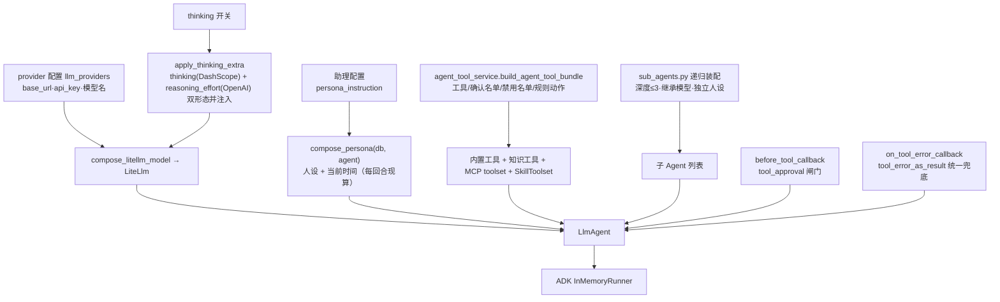

# Agent 装配与子代理架构

平台用 ADK（Google Agent Development Kit）的 `LlmAgent` 装配智能体，**禁止自研 agent loop**：产品侧只负责「按配置组装 + 回调闸门 + 事件桥接 + 持久化」，推理循环、工具调度、暂停恢复全部交给 ADK。装配层是全局收口——所有能力（工具、技能、子代理、MCP、审批、错误兜底）都在这里汇合。

## 三个装配工厂（adk_runtime/agent_factory.py）

| 工厂 | 用途 | 关键装配 |
|---|---|---|
| `build_chat_agent` | 对话主路径、playground、审批续跑 | 模型 + 人设 + 工具 + 技能 + 子代理 + before_tool_callback + on_tool_error_callback |
| `build_workflow_agent` | 工作流节点内的模型调用 | 同上但带 `WORKFLOW_LLM_TIMEOUT_SECONDS=180` 兜底 |
| `build_switch_agent` | 路由/切换用途的轻量 Agent | 精简装配 |

**要点**：

- `build_chat_agent` 签名支持外部注入 `before_tool_callback` / `sub_agents`；未注入时默认挂 `build_before_tool_callback(...)`。
- `SkillToolset` 用 EAGER discovery：目录（名称+描述）随会话装配可见，正文仍由 `load_skill` 按需加载（见《Skill架构》）。
- `apply_thinking_extra` 两种形态并注入——`thinking`（DashScope）与 `reasoning_effort`（OpenAI），「网关认哪种由它自己定」；custom provider 未声明时也强制注入。不强加 `openai/` 前缀或某家专属字段。
- `max_turns` 装配期校验（0 不限），实际限轮由 Runner 的 `RunConfig.max_llm_calls` 生效。

## 能力面装配八步（agent_service / agent_tool_service）

`build_agent_tool_bundle` 是一次装配的单一收口，按固定顺序合成最终能力面：

1. **技能解析**：`resolve_skills(db, agent.skills)` 得到运行时技能集合。
2. **工具白名单**：`effective_allowed_tools(agent, runtime_skills)`；MCP server 按白名单过滤。
3. **MCP 工具装配**：预热向量缓存后，二选一——
   - 无人值守节点已知要用哪些工具：`direct_mcp_tools=True` 时按名直接挂实体，跳过 search→load；
   - 对话路径：挂 `SearchableToolset`，白名单决定检索目录，命中的仍需 `search/load`。
4. **确认名单**：`confirm_tool_names_for_servers`（按 server 审批策略）+ 助理只读模式下该助理用到的全部 MCP 工具。
5. **禁用名单**：`agent_disallowed_tool_names`。若与技能声明工具冲突（配置漂移：技能后加声明、助理已屏蔽），留痕日志。
6. **非 safe 内置工具默认进闸**：如 `run_workflow`（risk=mutating）默认进确认名单；审批规则 `auto_approve` 可免审——**风险定级与是否审批是两根轴**。
7. **审批规则动作**：`resolve_actions` → `rule_actions` → `apply_rule_actions` 改写确认/禁用名单（首条命中，规则优先于 server 策略）。
8. **产出 bundle**：`allowed_tools / confirm_tool_names / disallowed_tool_names / rule_actions / runtime_skills` 交给 agent_factory 装配。

## 提示词三块来源

1. **CHAT_AGENT_INSTRUCTION**（全局纪律）：多工具节奏（说明→调用→结果说明→下一说明，禁止连发后补写）、澄清规则（缺必填实参/需选择时调 ask_user，禁止占位符先调用；一句话能问清才允许纯文本提问且 function call 数为 0）、图表规则（一律 `run_python` 的 chart 产出物，正文禁写 ECharts 配置或 JSON）。
2. **compose_persona**：`agent_service.compose_persona(db, agent)` 拼助理人设 + `## 当前时间`（本地时间 + 时区标签 + 星期，每回合现算）。这是 chat / 审批恢复 / playground / 子助理四路汇合点。
3. **工具返回值**：检索结果、代码输出等走工具通道，不人工拼进提示词。

长期记忆通过 `compose_memory_hint` 注入（见《记忆与工具索引架构》），同样属于第 2 块的一部分。

## 子代理装配（adk_runtime/sub_agents.py）

- **递归装配，深度上限 3**：`depth >= 3` 或无子代理时停止；保存时用 `agent_service.validate_sub_agents` 校验防环与深度，运行期按树递归安全。
- **继承模型、独立人设**：子代理继承父助理的模型配置，但用各自的 persona。
- **`include_ask_user=False`**：澄清提问只在与用户直接对话的根 Agent 上，子代理不挂 ask_user。
- 子代理失败/异常同样被 `on_tool_error_callback` 兜底，不打断父回合。

## 错误兜底：从根因统一处理（on_tool_error_callback）

**根因**：ADK 只对 MCP 工具内置异常兜底；其余工具抛错会一路冒泡，终止整个 agent 回合（对话轮次 / worker 一路）。若逐个包工具函数，会随工具增多而遗漏。

**根因修复**：在装配入口统一注册 `tool_error_as_result` 为 `on_tool_error_callback`（`build_chat_agent` / `build_workflow_agent` 都挂）。它把异常转成带原因的错误结果回给模型——可重试、不打断本轮——覆盖所有对话、子代理与排查 worker。日志 `工具执行失败 name=... err=...` 可追溯。

同理，无人值守的排查/汇总 worker（`agent_assembly.py`）因运行在无事件循环的 ADK 线程池，也复用这套装配与兜底，不另起一套。

## 无人值守装配（services/execution/agent_assembly.py）

任务图节点与收尾汇总的**唯一装配入口**，集中处理：会话/模型解析、工具包、知识范围、web 搜索、**只读闸门**、人设与工具聚焦。

- **只读闸门**：`build_readonly_tool_gate` + `filter_tools_by_focus` + `normalize_tool_focus` + `ToolFocus`；按节点声明的工具聚焦（如 `ANALYST_TOOL_NAMES` / `READONLY_TOOL_NAMES`）过滤，再挂只读回调——无人值守节点绝不能触发写工具。
- **工具聚焦引导** `FOCUS_GUIDANCE` 注入指令，约束节点只用聚焦工具。
- 装配入口记录会话/模型/工具数日志，便于排查与发现冗余调用。
- 唯一消费者是新架构 taskgraph；旧装配代码删除后无残留。

## 与审批/知识/工具的边界

- 审批闸门在 `before_tool_callback` 判定（详见《工具执行权限与审批规则》与《审批与澄清交互》），装配层负责挂接，不重复实现判定逻辑。
- 知识范围 `KnowledgeScope` 与 web 搜索开关在装配时注入，检索实现在 `services/knowledge`（详见《知识库与检索架构》）。
- 工具的目录、风险、实现在 `app/tools`（详见《内置工具与技能说明》）。

## 维护地图（改代码时同步更新）

| 变更 | 改哪里 |
|---|---|
| 工厂装配/回调/error 兜底 | `adk_runtime/agent_factory.py`、`adk_runtime/tool_error_as_result` |
| 能力面八步 | `services/agent/agent_tool_service.py`、`agent_service.py` |
| 子代理规则 | `adk_runtime/sub_agents.py`、`agent_service.validate_sub_agents` |
| 无人值守闸门 | `services/execution/agent_assembly.py`、`services/execution/tool_policy.py` |
| 思考形态 | `apply_thinking_extra` + provider 配置 |
