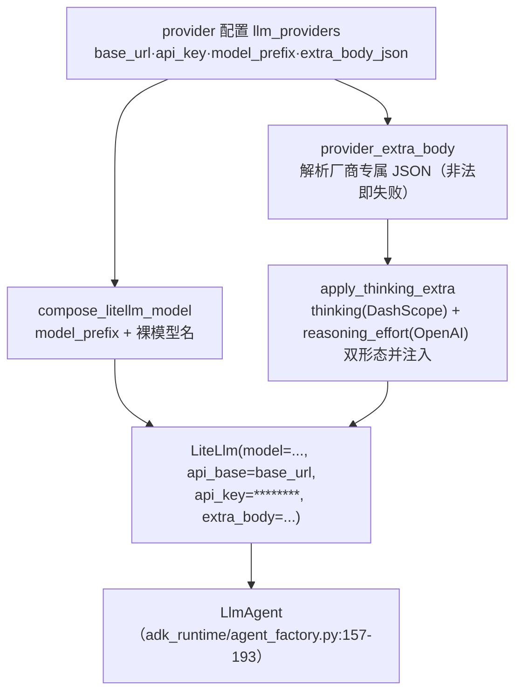
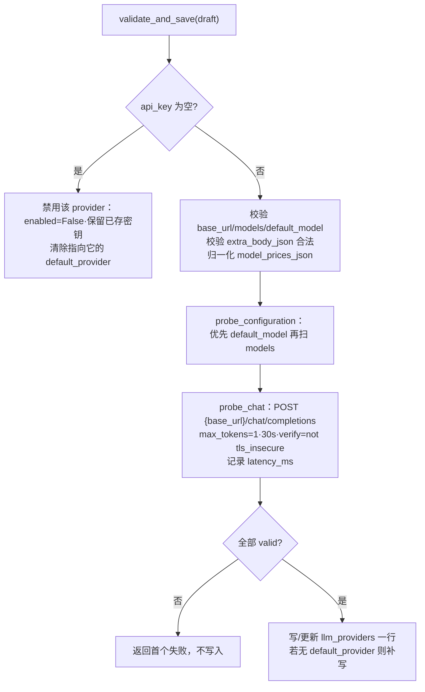
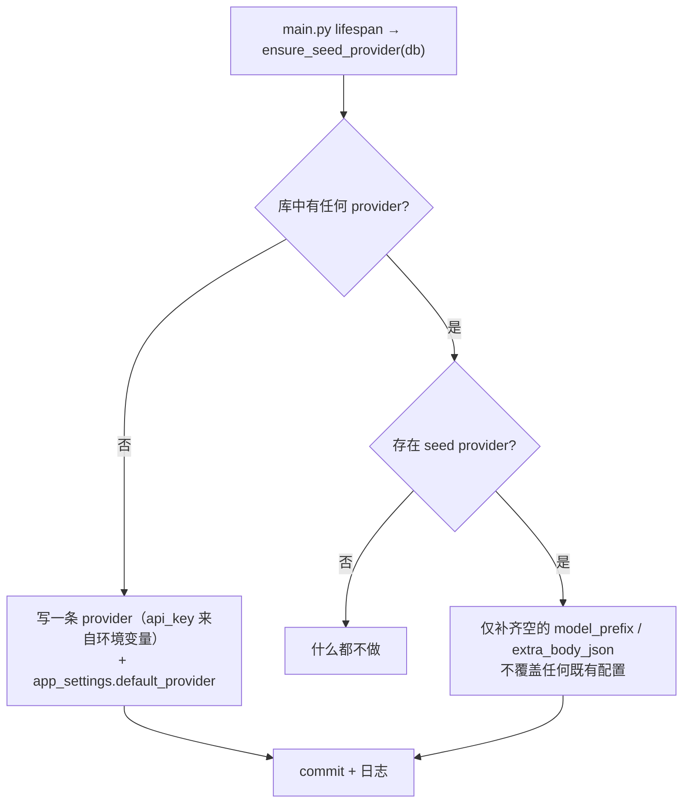

# LLM 供应商与模型配置架构

本文覆盖平台「模型从哪来、怎么装配、怎么校验、怎么计价」的完整链路。**核心设计原则：任意 OpenAI 兼容 provider 都能接入，不硬编码任何一家厂商的字段**；模型名前缀、厂商专属请求体、单价表全部由 provider 配置驱动，装配层只做通用拼装。配置数据唯一来源是 `llm_providers` 表，默认 provider 存在 `app_settings`。

## 配置数据模型（models/llm.py）

`llm_providers` 一行 = 一个 provider 及其可用模型列表。字段如下：

| 字段 | 类型 | 含义 |
|---|---|---|
| `provider_id` | str, unique | provider 标识（如 `custom`），业务与 API 都按它引用 |
| `label` | str | 展示名 |
| `base_url` | str | OpenAI 兼容端点根地址 |
| `api_key` | Text | 密钥明文落库（列表/reveal 处脱敏，见下文） |
| `models` | Text | 逗号分隔的模型名，**顺序敏感**；index 0 可作默认候选 |
| `default_model` | str | 该 provider 的默认模型，必须在 `models` 内 |
| `enabled` | bool | 是否启用；空 key 保存会置 False（见「连通性与保存」） |
| `model_prefix` | str | LiteLLM 模型名前缀（如 `openai/`）；空串表示不加前缀；`custom` 必须非空 |
| `extra_body_json` | str | 厂商专属请求体（JSON 文本），只对确实需要的 provider 配 |
| `tls_insecure` | bool | 跳过 TLS 证书校验（自签证书场景）；须真正作用到探测/运行客户端 |
| `model_prices_json` | str\|None | 手动单价表（JSON 文本），每百万 token 单价；NULL/缺模型 = 未计价 |

- `app_settings` 是通用键值表（`key / value`），**默认 provider 以 `key="default_provider"` 存在这里**，值是 provider 的 `provider_id`。
- 密钥只在库里以明文存；任何对外/对前端输出都走掩码或 reveal 审计，绝不随列表外泄（见「API Key 掩码与 reveal」）。

## LiteLlm 装配（services/platform/llm_config.py）

`compose_litellm_model()` 在**装配 agent 时**才把 `model_prefix` 拼到上游模型名前面——库里与页面只存上游裸模型 id。规则：模型名为空显式失败；`provider_id == "custom"` 且 `model_prefix == ""` 显式失败；前缀为空则原样返回。这样 OpenAI 兼容端点靠 `openai/` 前缀就能走 LiteLLM 的 OpenAI 通道，而不必给所有 provider 写死同一前缀。

`provider_extra_body()` 解析厂商专属 JSON：空串返回 `{}`；配了但非法 JSON 显式抛错（不能静默忽略，否则用户以为配置生效了）；非 JSON 对象抛 `TypeError`。

**装配点 `adk_runtime/agent_factory.py:157-193`**：最终构造 `LiteLlm(model=litellm_model, api_base=base_url, api_key=api_key, timeout=..., extra_body=...)`；`api_key` 与 `extra_body` 都来自 provider 配置，日志只记 `extra_body_keys` 与思考开关，不落密钥。

`apply_thinking_extra(extra_body, thinking_enabled, provider_id)` 就地改写并按开关注入两种思考形态：

- `thinking`（DashScope 形态）：`{"type": "enabled"|"disabled"}`——`extra_body` 已声明该字段时按开关改写，`custom` 未声明也强制注入。
- `reasoning_effort`（OpenAI 形态）：开=`medium`、关=`none`——同样声明了就改写，`custom` 也注入。

**两种形态并注入，网关认哪种由它自己定**；不强加 `openai/` 前缀或某家专属字段（详见《Agent装配与子代理架构》）。

**跨处一致性**：`compose_litellm_model` / `provider_extra_body` 被 chat、审批恢复、playground、子代理、executor、eval judge、工作流、`auto_summary` 等模型调用点复用（前缀与厂商请求体的拼装口径统一在这两处）——改动前缀或 `extra_body_json` 解析需全局一致。需注意：**思考字段注入（`apply_thinking_extra`）只在 `adk_runtime/agent_factory.py` 的主对话装配点生效**；eval judge 与 `auto_summary` 只复用模型/请求体拼装，不注入 thinking/reasoning_effort，即评测裁判与自动摘要不受对话思考开关控制。

## 手动价与用量口径（llm_admin._normalize_model_prices）

`model_prices_json` 是唯一的成本口径，格式 `{"<模型名>": {"input_per_1m": x, "output_per_1m": y}}`（每百万 token）。`_normalize_model_prices(raw, models)` 在保存时校验：

- 价目条目**必须都在 `models` 里**，否则显式失败（`unknown` 列表报出）。
- 空表归一为 `NULL`（不是 `"{}"`），表示该 provider 未定价。

用量看板**只认这里的手动价**：缺价显示「未计价」，**绝不造假 0**（详见《沙盒与可观测架构》）。保存链路懒导入 `usage_service.parse_model_prices` 复用同一解析口径，避免平台层与可观测层顶层互引。

## API Key 掩码与 reveal

- **列表掩码**：`list_llm_settings()` 把 provider 展平为前端 `system-settings(category=llm)` 形状；`api_key` 项恒定标记为 `sensitive`，值在启用且有 key 时显示掩码 `********`，未启用或空 key 显示空串（前端据此隐藏/视为未配置）。密钥明文绝不进列表。
- **reveal 明文**：`reveal_api_key(db, provider_id)` 返回明文，由管理入口调用并写 `setting.reveal` 审计（见《凭证与只读分享架构》）；provider 不存在或空 key 显式失败。
- 审计 `llm.test` / `llm.save` 的 detail 只记配置外形（base_url、default_model、models、model_prefix、tls_insecure、`api_key_changed` 布尔），**永不落密钥值**。

## 连通性测试与保存（llm_admin）

- `probe_chat()`：对单模型发最小 `POST {base_url}/chat/completions`（`max_tokens=1`，`messages=[{role:user, content:ping}]`，`Authorization: Bearer ********`，超时 30s，`verify=not tls_insecure`），记录 `latency_ms`；非 200 返回 `http_<code>` + 截断 detail。
- `probe_configuration()`：**优先 `default_model`，再扫 `models` 列表**；任一失败立即返回，不继续。
- `fetch_remote_models()`：拉 `GET {base_url}/models`，要求响应含 `data` 数组且每项有非空字符串 `id`，否则显式失败。
- `validate_and_save()`：**空 `api_key` = 禁用该 provider**（`enabled=False`、保留已存密钥——删密钥不可恢复，停用只需清空语义由空 key 触发；并清除指向它的 `default_provider`，否则模型目录整体报错且用户拿不到任何模型）。provider 不存在时禁用显式失败，不谎报 saved。非空则校验通过、探测通过后写入/更新；`default_provider` 缺失时补写。`tls_insecure` 为真时记 warning 日志。

上游不可达（连接失败/超时/TLS 错误）时，API 层统一转 502，不让 `httpx` 异常冒泡成 500 traceback。

## Seed 幂等机制（services/platform/llm_config.py）

`ensure_seed_provider()` 由 `main.py` 的 lifespan 在启动时调用，用 `SEED_LLM_*` 环境变量（`SEED_LLM_PROVIDER / BASE_URL / API_KEY / MODEL / MODEL_PREFIX / EXTRA_BODY_JSON`）初始化，保证首次开箱可用且**幂等**：

- 库空时：写一条 provider（`base_url / api_key / models / default_model / enabled=True / model_prefix / extra_body_json`）+ 一条 `default_provider` 设置。
- 已有数据时：若 seed provider 存在，**只把非空种子值补进空的 `model_prefix` / `extra_body_json`**（对话请求依赖 `openai/` 前缀拼模型名），有值就绝不覆盖；没有 seed provider 则什么都不做。
- 种子密钥只来自环境变量注入，文档的列表/reveal/审计环节都不出现其值。

## 管理 API（api/integrations_llm.py）

三个端点均为 `require_admin`：

| 端点 | 作用 | 审计 |
|---|---|---|
| `POST /integrations/llm/test` | `probe_configuration` 探测 draft | `llm.test`（只记外形，不落 key） |
| `POST /integrations/llm/validate-and-save` | `validate_and_save` 校验并持久化 | `llm.save`（含 `api_key_changed` 布尔，不落 key） |
| `POST /integrations/llm/models` | `fetch_remote_models` 拉远端模型清单 | 不审计（纯查询，无状态变化） |

`LLMConfigIn` 用 `extra="forbid"` 严格拒绝多余字段；上游不可达统一 502。`test` / `save` 均写审计，纯查询的 `models` 不写（见《沙盒与可观测架构》审计约定）。

## 设计原则总结

1. **通用优先**：任意 OpenAI 兼容 provider 皆可接入；前缀、厂商请求体、单价全部配置驱动，不硬编码某家字段，不强加 `openai/` 前缀或某家 thinking 字段。
2. **不静默降级**：非法 JSON、不在 `models` 里的价目项、无模型列表、上游非 200 全部显式失败。
3. **缺价不造假**：成本只认手动价，缺价「未计价」而非 0。
4. **密钥不外泄**：列表掩码 `********`、reveal 走审计、审计 detail 永不落 key。
5. **空 key 即禁用**：保留密钥、清除 `default_provider` 指向，不删行、不谎报。
6. **seed 幂等**：只在库空时写全量，已有 seed 只补空缺字段，不覆盖既有配置。

## 维护地图（改代码时同步更新）

| 变更 | 改哪里 |
|---|---|
| 表结构/字段 | `models/llm.py`（`llm_providers`、`app_settings.default_provider`） |
| 模型名前缀/厂商请求体/seed | `services/platform/llm_config.py`（`compose_litellm_model`、`provider_extra_body`、`ensure_seed_provider`） |
| 思考形态注入 | `adk_runtime/agent_factory.py`（`apply_thinking_extra`、装配点 157-193） |
| 手动价/连通性/保存/掩码/reveal | `services/platform/llm_admin.py`（`_normalize_model_prices`、`probe_chat`、`probe_configuration`、`fetch_remote_models`、`validate_and_save`、`reveal_api_key`、`list_llm_settings`） |
| 管理 API/审计 | `api/integrations_llm.py`、`services/observability/audit_service.py` |
| 用量计价口径 | `services/observability/usage_service.py`（见《沙盒与可观测架构》） |
| seed 启动调用 | `main.py` lifespan、`config.py`（`SEED_LLM_*`） |
