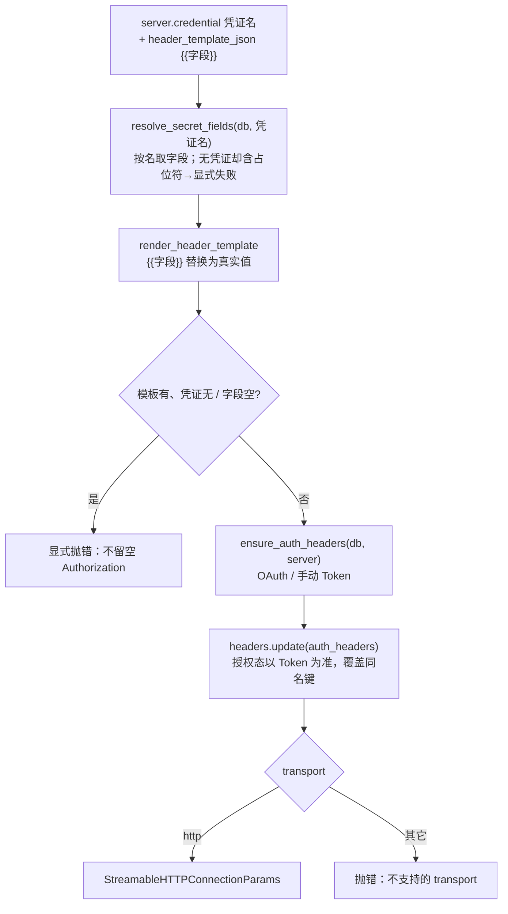
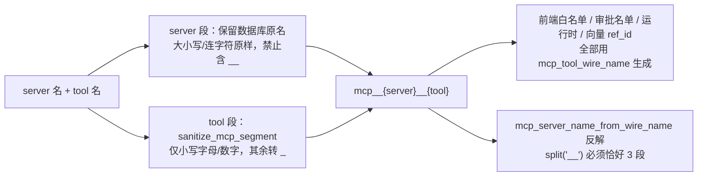
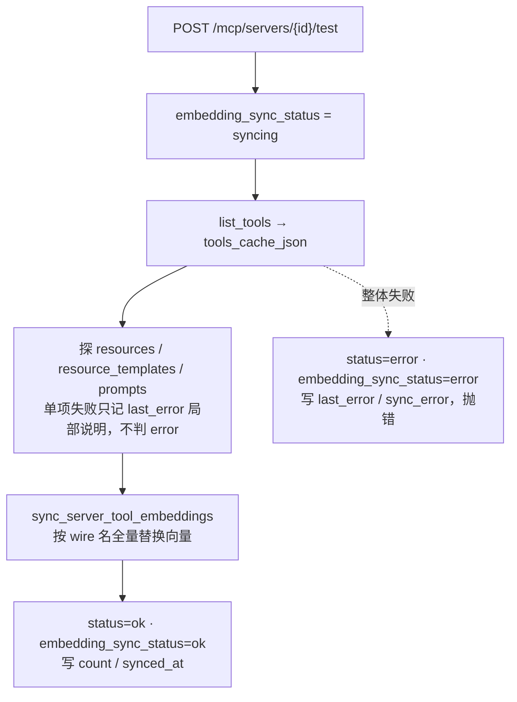
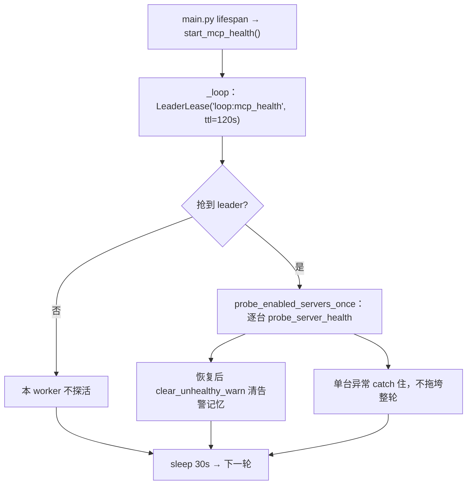
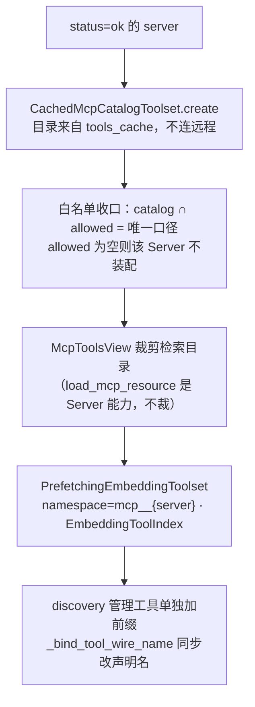
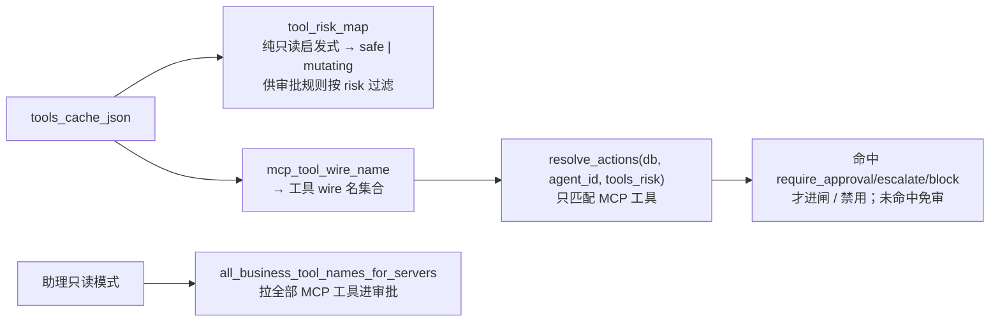

# MCP 全链路架构

本文覆盖外部 MCP Server 从**登记配置 → 鉴权装配 → 发现探测 → 向量索引 → 运行时装配 → 审批收口**的完整链路。核心设计原则：**wire 工具名唯一权威**、**配置与状态彻底分离**（凭证只存名字、工具向量只存元数据）、**发现与探活分工**（重活手动、轻活后台）、**入口单一收口**（白名单 + view 在装配处裁剪，不散落各层）。审批闸门流程见《工具执行权限与审批规则》，工具向量索引的检索细节见《记忆与工具索引架构》，本文只讲 MCP 侧装配与来源，不重复展开。

## 配置模型（models/mcp.py）

两张表：`mcp_servers` 存注册信息与状态，`mcp_tool_embeddings` 只存检索元数据——**向量本体在向量库 `namespace=mcp_tools`**（见《知识库与检索架构》），本表不留向量。

`mcp_servers` 关键字段分组：

| 组 | 字段 | 说明 |
|---|---|---|
| 身份/连接 | `name`（unique）、`transport`、`endpoint`、`command`/`args_json`/`cwd`/`env_json` | `transport` 仅 `http`/`stdio` 两种；`endpoint` 是 http 远程 URL，stdio 用 command 等字段 |
| 鉴权 | `credential`、`header_template_json` | `credential` 存**凭证库里的凭证名**，不是密钥；模板用 `{{字段}}` 占位符 |
| 可用性 | `enabled`、`status`、`last_error`、`last_probed_at` | `status` 由探活/探测维护，装配时按 `status != ok` 跳过 |
| 工具缓存 | `tools_cache_json` | 探测结果，发现阶段只读它，不连远程 |
| 附加能力缓存 | `resources_cache_json`、`prompts_cache_json`、`resource_templates_cache_json` | 探测时写入，列表展示不连远程 |
| 向量同步 | `embedding_sync_status`、`embedding_sync_count`、`embedding_sync_error`、`embedding_synced_at` | `idle` / `syncing` / `ok` / `error` |

`mcp_tool_embeddings` 只存 `tool_name` / `search_text` / `content_hash`（按 `server_id + tool_name` 唯一），用于向量复用（content_hash 命中则复用旧向量）与一致性校验。

## 连接方式仅两种 + 传输归一

**只支持 `http`（StreamableHTTPConnectionParams）与 `stdio`（StdioConnectionParams），没有 sse**（`connection_params_for_server()`，mcp_service.py）。其它 transport 值显式抛 `不支持的 MCP transport`，不静默降级。

Registry 代理（`mcp_registry_service.py`）把官方注册表的 transport 归一：所有 remote 一律映射为 `http`（sse 条目也按 http 处理）。注册表条目转登记表单时只做预填—— remote URL 直接填入，包形式给部署提示但不猜 endpoint；网络不可达显式抛错，不做静默降级。

## 鉴权装配（按凭证名取字段 → 渲染模板 → Token 覆盖）

`connection_params_for_server()` 是连接参数的唯一装配入口，顺序固定：

注：stdio 分支在渲染 header 模板之前单独走 `StdioServerParameters`（command/args/env/cwd），不经此图的 http 路径。

要点：

- `credential` 列存的是**凭证名**，密钥本体在凭证库（见《凭证与只读分享架构》），`secret_to_wire` 永不回传明文/密文。
- `render_header_template()` 对「模板里出现但凭证没有的字段」以及「字段值为空串」**显式抛错**——避免发出空 `Authorization` 这种极难排查的现场。
- OAuth / 手动 Token 经 `ensure_auth_headers()` 以 `headers.update()` 覆盖同名键：授权态以 Token 为准。

## Wire 工具名：唯一权威

`mcp__{原始 server 名}__{规范化 tool}`，双 `__` 分段（`mcp_service.py:136-202`）：

规则细项：

- **server 段保留原值**：大小写、连字符都不改，否则 `add-work` 与 `add_work` 会在 wire 上撞名；写入时 `assert_mcp_server_name()` 拒绝 server 名含 `__`（会破坏反解）。
- **tool 段规范化**：`sanitize_mcp_segment()` 只保留小写字母与数字，其余字符（含大写转小写）统一转 `_`；规范化后为空显式失败。
- **反解** `mcp_server_name_from_wire_name()` 要求恰好 3 段且中段/尾段非空，否则抛「非法 MCP 工具名」。
- **单一权威**：前端助理白名单、后端审批名单、运行时工具名、向量库 `ref_id` 全部由 `mcp_tool_wire_name()` 生成；管理工具（discovery）前缀由同源的 `mcp_toolset_name_prefix()` 生成。启动时 `assert_embedding_names_consistent()` 校验向量 `tool_name` 与 wire 规则一致，不一致即暴露（main.py lifespan）。

## 工具发现与健康检查的分工

两类操作职责严格分离——**重活手动、轻活后台**：

| 操作 | 做什么 | 更新范围 |
|---|---|---|
| `probe_server_health()`（:1015） | 仅 `initialize` 握手 + `send_ping`，各 10s 超时 | 只更新 `status` / `last_error` / `last_probed_at`；**不刷工具缓存、不探附加能力、不动嵌入同步** |
| `test_server()`（:1047） | 全量：`list_tools` → 写缓存 → 探附加能力 → 同步向量 → 更新同步状态 | `tools_cache_json` + 三类附加缓存 + `tools` + `embedding_sync_*` |

`test_server()` 全量刷新流程：

要点：

- 附加能力探测失败只把说明拼进 `last_error`，**tools 仍是主判据**，不因单项能力失败把 server 判为 error。
- 探针成功的 close 也套 2s 超时——连接失败时 SDK close 会等会话任务超时，别让探活循环被单台拖住。

## 后台探活（services/mcp/mcp_health.py）

`start_mcp_health()` 由 `main.py` lifespan 启动，30s 一轮：

- **多 worker 只一台探活**：用 `LeaderLease("loop:mcp_health", ttl=120s)`（见《Redis强依赖与多worker协同架构》）保证同一 Server 不被重复探测/告警。
- **单台异常不拖垮整轮**：逐台 `try/except`，整轮外层再兜一层，异常只记日志，下一轮重试。
- **告警去重**：`warn_unhealthy_server()` 对同一 Server 的同一故障只 WARNING 一次，恢复后清记忆，便于下次故障重新告警。

## 动态 toolset 两条装配路径（mcp_service.py:396 / :479）

两条路径都**跳过 `status != ok` 的 server**（记 `site=build_toolset` / `build_direct_toolset` 日志，不拖垮整体装配），都靠 `namespace=mcp__{server}` 的 view 做白名单收口。

### build_searchable_mcp_toolsets（默认/对话侧：search → load）

工具**不进初始上下文**：用 `CachedMcpCatalogToolset`（读 DB 缓存，发现阶段不连远程）+ `PrefetchingEmbeddingToolset`（`EmbeddingToolIndex`），模型按需 search/load。

要点：

- **白名单是唯一口径**：助理 `tools` 为空 = 不挂任何 MCP Server；非空时未勾选工具不进检索目录（既不出现在检索结果也调不了），被勾选的工具同样走 search/load，不直塞。
- 管理工具（discovery）单独加 `mcp__{server}__` 前缀，且用 `_bind_tool_wire_name()` **同时改运行时 name 与 FunctionDeclaration.name**——只改 name 会导致模型仍按旧名调用。
- 白名单在该 Server 上命中 0 个工具时不装配、不留检索入口。

### build_direct_mcp_toolsets（无人值守节点：已知工具直挂）

已知要用哪些工具时按 wire 名直挂实体（`McpDirectToolset`），初始上下文即拿到工具，**省掉 search/load 轮次**。白名单即唯一口径：`source ∩ allowed` 命中才挂，未声明的一个都不挂；同样用 `McpToolsView` 按 `namespace=mcp__{server}` 收口。

## 风险标签与审批（mcp_service.py）

审批策略（per-server `approval_policy`）已删除，MCP 工具默认免审：

- **风险轴**：`tool_risk_map()` 按只读启发式给每个缓存工具打 `safe`（只读）| `mutating`（非只读/未知），供审批规则 `risk` 维度过滤，缓存空时返回空映射不报错。
- **审批轴**：MCP 工具默认不进确认名单（免审直跑）；只有命中审批规则（require_approval / escalate / block）才进闸或禁用，规则按工具名 / 助理 / risk 匹配。per-server 三档策略已删除。
- 内置工具不走审批规则，按 `tools/catalog.py` 的 risk 独立进闸（非 safe 默认要确认）。
- 助理只读模式用 `all_business_tool_names_for_servers()` 拉**全部** MCP 工具进审批。
- 审批闸门与规则覆盖流程见《工具执行权限与审批规则》，此处只交代 MCP 侧来源。

## 其他模块

- **mcp_oauth_service.py**：RFC 元数据发现 → DCR 动态注册 → 授权码 + PKCE（S256）→ token 刷新；`STATE_TTL_MINUTES=10`；兼容手动 token；wire 状态 `none | authorized | expired`。不走 mcp SDK 的 OAuthClientProvider，自管 token 行（密文复用同源密钥）。
- **mcp_registry_service.py**：官方 registry（`registry.modelcontextprotocol.io`）搜索，条目转登记表单预填；名称中 `__` 替换为 `-`（wire 约束）、超长截断；网络不可达显式抛错。
- **api/mcp.py**：server CRUD / test / run、resources / prompts / resource-templates 列举与读取、registry 搜索、OAuth 端点（start / callback / token / status / delete）。管理页 run 走 `run_tool()`，不经 Agent / 审批。
- **参数 schema coercion**（mcp_service.py:647-733）：`coerce_arguments_from_schema()` 按 input_schema 把画布参数转类型并校验必填——integer/number/boolean/string 显式转换（bool 不作整数），object/array 以 JSON 文本录入，未知/联合类型不猜、原样交 Server 校验。

## 维护地图（改代码时同步更新）

| 变更 | 改哪里 |
|---|---|
| 表字段/状态机 | `models/mcp.py`（`mcp_servers` / `mcp_tool_embeddings`） |
| transport / 鉴权装配 | `mcp_service.py` 的 `connection_params_for_server` / `render_header_template` |
| wire 命名规则 | `mcp_service.py` 的 `sanitize_mcp_segment` / `mcp_tool_wire_name` / `mcp_server_name_from_wire_name`（联动前端白名单与 `tool_search_index`） |
| 发现/探活分工 | `mcp_service.py` 的 `probe_server_health` / `test_server` |
| 后台探活循环/间隔/租约 | `services/mcp/mcp_health.py` + `main.py` lifespan |
| toolset 装配/白名单收口 | `mcp_service.py` 的 `build_searchable_mcp_toolsets` / `build_direct_mcp_toolsets` + `mcp_catalog_toolset.py` |
| 风险定级 / 审批规则 | `mcp_service.py` 的 `tool_risk_map`（闸门与规则见《工具执行权限与审批规则》） |
| OAuth | `services/mcp/mcp_oauth_service.py` |
| Registry 归一 | `services/mcp/mcp_registry_service.py` |
| API 端点 | `api/mcp.py` |
| 参数 coercion | `mcp_service.py` 的 `coerce_arguments_from_schema` |
| 工具索引与检索 | 见《知识库与检索架构》（`services/mcp/tool_search_index.py`） |
