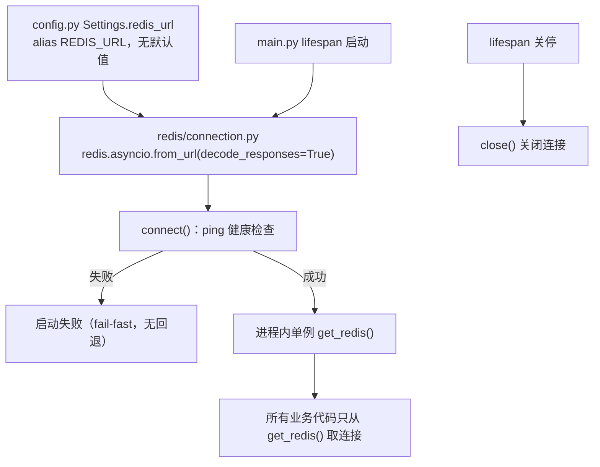
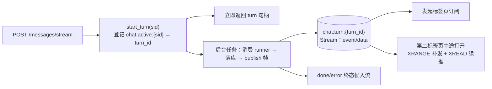

# Redis 强依赖与多 worker 协同架构

本平台把 Redis 作为**强依赖**：所有跨进程协同（帧分发、事件广播、锁、停止信号、共享状态、通知）与多 worker 一致性都收口到 Redis，不保留进程内回退。权威业务数据仍在数据库，Redis 只承载「协同态」与「传输通道」，两者职责严格分离。

之所以这样设计，是因为单机 `dict + deque + asyncio.Queue` 的进程内实现无法支撑多 worker 与多标签页：生产与消费被 HTTP 连接绑死，连接断开产出即停，第二标签页拿不到进行中的增量，跨 worker 的事件/锁/停止全部失效。

## 连接与生命周期（app/redis/）

- **强依赖**：`REDIS_URL` 是必填配置；`connect()` 在 lifespan 中 `ping`，失败即启动失败。没有「不配 Redis 就退回内存」的分支。
- **唯一入口**：所有业务代码只从 `app.redis.get_redis()` 取连接，禁止散落 `from_url`。连接串在日志里走 `_redact` 脱敏（不打印密码）。
- **生命周期对齐**：`main.py` lifespan 中 `connect()` 与 vector_store、engine 同级，在 `yield` 前完成；关停时 `close()`。

## 五类 Redis 用法总览

| 能力 | Redis 结构 | key 约定 | 主要模块 |
|---|---|---|---|
| 对话帧分发 | Stream | `chat:turn:{turn_id}` / `chat:active:{sid}` | `services/chat/chat_stream_bus.py` |
| 工作流/任务图事件 | Stream | 每 run 一个 Stream | `services/workflow/workflow_events.py`、`services/taskgraph/task_graph_events.py` |
| 全局通知 | Stream | `notify:{uid}` | `services/platform/notification_bus.py`、`api/events.py` |
| 分布式锁 | String（SET NX PX） | `lock:{name}` | `services/platform/redis_distributed.py` |
| 停止信号/共享标志/集合 | PubSub + Hash/Set | stop / flag 频道 | `services/platform/redis_distributed.py` |

## 对话帧总线：生产消费解耦（阶段1）

核心改造是**把帧生产从 HTTP 连接拉取改成后台任务主动推送**：后台任务消费 `stream_session_message`（含 `AdkFramePersister` 落库），逐帧 `XADD` 到本回合 Stream；所有订阅者（含发起者）统一从 Stream 读，不重复落库。

**key 约定与参数**（`chat_stream_bus.py`）：

- `chat:turn:{turn_id}`：Stream，字段 `event` / `data`（JSON）；`MAXLEN=5000`，首帧起 `TURN_TTL=1800s` 自动回收。一回合一个 Stream，天然隔离历史回合。
- `chat:active:{sid}`：Hash，字段 `turn_id` / `started_at` / `status`，`ACTIVE_TTL=3600s`；后台任务崩溃时自动过期，避免永久「进行中」。`finish_turn` 把 status 更新并把 TTL 缩短到 60s。
- **Stream ID 即全局单调 seq**：订阅者用它做游标，支持 `Last-Event-ID` 续传。

**两段式订阅 `subscribe(turn_id, last_id)`**：

1. **补发历史**：`XRANGE key start +`，`last_id=0-0` 时用 `-`（含全部；`(0-0` 是非法 Stream ID），否则用 `(last_id` 开区间。逐帧 `yield (stream_id, event, data)`，读到 `done/error` 即结束。
2. **实时续推**：`XREAD BLOCK 1000 COUNT 100` 循环，无新帧返回 None 继续（可被连接断开取消）；同样遇终态帧结束。

- 终态帧 `done` / `error` 也在流里，后到者能看到完整回合。
- 不持有服务端订阅状态——Stream 本身常驻，断开只需取消生成器。
- 大 payload（图表数据）不塞 Redis，仍走 artifacts 表，Stream 只传事件与引用。

## 事件总线跨进程化（阶段2）

两个事件总线（`workflow_events.py` / `task_graph_events.py`）从进程内 `dict + deque + asyncio.Queue` 改为 Redis Stream + 本地 `asyncio.Queue` 桥接：

- `publish` → `XADD`；`subscribe` → `XRANGE` 补 backlog + 后台读任务 `XREAD` 写本地 queue；`unsubscribe` 取消读任务。
- **保留公开签名**（`publish/subscribe/unsubscribe/open/is_finished`）与「补发 + 续推」语义，SSE 端点逻辑不动。
- 沿用原保留策略常量（600s / 3600s / 200 runs / 2000 events / 1000 queue）作为 Stream `MAXLEN` 与 TTL 依据。
- 裁剪用 `XADD approximate=False` **精确裁剪**：实测 `approximate=True` 会近似裁剪导致缓冲长度不稳（如期望 2000 实得 2050），测试要求精确边界。
- 两个 Stream 各有独立游标，不共享 seq。

## 分布式锁与共享状态（阶段3）

`redis_distributed.py` 提供四类原语，供各模块替换单进程实现：

**1. 分布式锁 `RedisLock`**（替代渠道锁、刷新锁等）：
- 获取：`SET key token NX PX ttl_ms`，token 为 `uuid4().hex`，唯一。
- 释放：用 Lua 脚本校验值再删——`if redis.call('get',KEYS[1])==ARGV[1] then return redis.call('del',KEYS[1]) else return 0 end`，**禁止无校验 DEL**（否则会释放他人的锁）。

**2. Leader 租约 `LeaderLease`**：`@asynccontextmanager` 包住常驻循环体，`try_hold()` 抢到才执行，`finally` 释放。三个常驻循环（触发器调度、知识库 vault 同步、MCP 健康探测）用它保证多 worker 只有一个实例在跑。

**3. 停止信号广播**：`request_stop` 以 Redis 为准判定活跃（本地集合或 `exists(active_key)`），保证跨 worker 点停止都能命中；`is_stopped` 同步只读本地集合镜像（ADK 的 `stop_check` 要求同步 callable 且高频调用）。订阅线程 `_listen_stops` 同时监听两个 channel，把停止标志落到本地集合。`task_control` / `turn_control` / `run_control` 与任务图私有实例统一委托到这里。

**4. 共享标志 / 集合**：`set_flag/get_flag/sync_flag`（PubSub 广播 + `_local_flags` 本地镜像）、`set_add/set_members/set_has`。`_GraphRuntime` 的 stop_requested、running、node_uids 全部迁移到 Redis 结构。

锁使用点：渠道锁 `channel_lock`（`publish_service.py`）、刷新锁（`task_graph_service.py`）、Leader 租约（三个循环）、`_GraphRuntime` 内部状态。

## 通知总线替换前端轮询（阶段4）

`notification_bus.py` 为每个用户建 Stream：`notify:{uid}`，`MAXLEN=500` 精确裁剪，`TTL=3600s`。通知**只带信号、不带大数据**，前端收到后重拉权威数据。

- 发射点：chat_refetch（落库）、approval_decided（审批决定）、graph_created/graph_finished（任务图）、knowledge_sync_done（知识同步）、eval_run_done（评测）。
- uid 从 `user.id` 解析；`Last-Event-ID` 请求头做续传。
- 前端页面轮询降级为兜底：ChatThread 30s、KnowledgeSources 5s + 事件、EvalDataset 事件 + 5s、ApprovalDetail 精确监听 + 30s。

**NotificationKind 全表（6 种，发射点 → 前端消费）**：

| kind | 发射点 | 前端消费（useNotifications） |
|---|---|---|
| chat_refetch | chat_stream_orchestrator（落库） | requestChatRefetch |
| approval_decided | approval_service | chatLiveBus approval_decided |
| graph_created | task_graph_service | 工作台切到新图 |
| graph_finished | task_graph_service | requestChatRefetch + graph_created |
| knowledge_sync_done | knowledge_sync | window KNOWLEDGE_SYNC_EVENT |
| eval_run_done | eval_runner | window EVAL_RUN_EVENT |

> **区分两套事件机制**：NotificationKind 是跨标签页的「刷新信号」（上表，走 `notify:{uid}` Stream + `/events`）；SSE 帧事件（assistant_delta / tool_start / tool_end / approval_pending / node_started 等）是单次运行的数据流，走对话帧总线或工作流/任务图事件 Stream。前者只带信号、前端重拉权威数据；后者带实际数据增量。

## 多 worker 与 Windows 限制（阶段5）

- `scripts/service.ps1`：仅当设置 `UVICORN_WORKERS=N` 时才加 `--workers`，本地默认单 worker。
- **Windows 限制实测**：uvicorn `--workers` 用 SO_REUSEPORT 共享监听 socket，在 Windows 上报 `WinError 10022`，实际只有 1 个 worker 存活。因此本地默认单 worker；多 worker 能力在类 Unix 环境启用，架构本身已按多 worker 正确性设计。
- 多 worker 正确性依赖：所有跨进程态在 Redis、常驻循环 Leader 选举、锁用 Redis、停止信号广播、通知用 Stream——不依赖任何「同进程」假设。

## 已知边界（如实记录）

- 生产者所在 worker 若进程崩溃，该回合后台生产任务随之消失（本次不做任务持久化/重新调度）；Redis Stream 保留已产出帧，前端可读到断点。
- Redis 强依赖意味着 Redis 不可用会导致后端启动失败与运行期报错——这是刻意选择，避免「悄悄降级」造成的隐性不一致。

## 维护地图（改代码时同步更新）

| 变更 | 改哪里 |
|---|---|
| 连接/配置/生命周期 | `app/redis/`、`config.py`（redis_url）、`main.py` lifespan |
| 对话帧语义/key/TTL | `services/chat/chat_stream_bus.py` + `web/src/api/sse.ts` |
| 事件总线保留策略 | `services/workflow/workflow_events.py`、`services/taskgraph/task_graph_events.py` |
| 锁/租约/停止/共享状态 | `services/platform/redis_distributed.py` 及调用方 |
| 通知种类/续传 | `services/platform/notification_bus.py`、`api/events.py`、`web/src/lib/useNotifications.ts` |
| 多 worker 启动 | `scripts/service.ps1`（UVICORN_WORKERS） |
