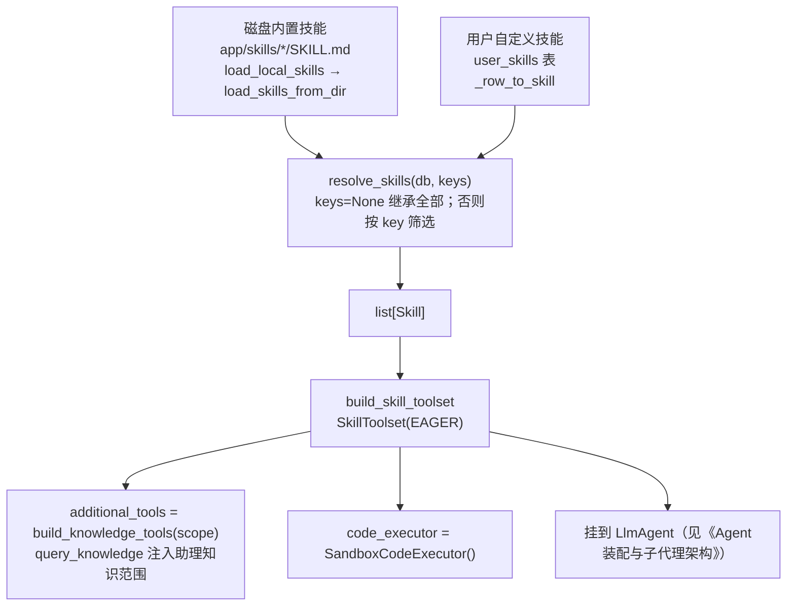

# Skill 架构

Skill（技能）把「可复用的领域工作流 + 脚本 + 参考资料」打包成 ADK 原生 Skill，供智能体按需加载。特点是：**磁盘内置技能与数据库用户技能统一装成同一个 ADK Skill**，目录用 EAGER 发现、正文按需注入，技能脚本一律在沙盒执行，绝不回落宿主机。

## 技能的两个来源，统一一种形态（skills_service.py）

- **磁盘锚定 app 包内**：`skills_dir()` 按 `app` 包位置推导，不随模块层级搬动失效。内置目录如 `app/skills/knowledge-search/`。
- **DB 用户技能**：`UserSkill` 表存 payload，读取时 `_row_to_skill` 还原成 ADK `Skill`；分组以列为准，metadata 存同份值供 SKILL.md 导出往返。
- **解析口径**：`resolve_skills(db, keys)`——`keys=None` 继承全部（磁盘 + 用户技能）；否则按 key 筛选。助理勾选的技能集合由此决定。
- 装配时打日志 `装配技能 skills=[...] knowledge_tools=N`，便于发现冗余。

## EAGER 发现 + 按需加载

`build_skill_toolset` 用 `SkillDiscoveryMode.EAGER`：目录（名称 + 描述）写入系统提示，让模型知道有哪些能力，**避免无差别 `list_skills`**；真正的正文与脚本靠 `load_skill` 按需注入。

- `scope`（助理知识范围）注入给 `query_knowledge`：空 = 全库，非空 = 助理限定目录/文档（见《知识库与检索架构》）。
- 技能声明的工具（`allowed-tools`）经 `_skill_declared_tools` / `declared_tools_of_skills` 汇总；若助理禁用名单与技能声明冲突（配置漂移：技能后加声明、助理已屏蔽），装配时留痕告警（见《Agent装配与子代理架构》八步）。

## 技能包格式与校验（skill_bundle.py）

一份技能包 = `SKILL.md`（frontmatter + 正文）+ 可选 `references/` / `assets/` / `scripts/`。

- **frontmatter 合法键**（`ALLOWED_FRONTMATTER_KEYS`，对齐 ADK）：`name` / `description` / `license` / `compatibility` / `allowed-tools` / `allowed_tools` / `metadata`。多写一个即拒绝。
- **风险等级 `RISK_LEVELS`**：`safe | mutating | dangerous`（平台侧属性，ADK 规范外新增；写进 metadata 供 SKILL.md 往返）。审批规则的 risk 过滤也用这三档（`RULE_RISKS = RISK_LEVELS`）。
- **zip 导入防穿越**：`payload_from_zip` 直接复用 ADK 的 `_load_skill_from_zip_bytes`（不另写一套）——SKILL.md 必须在压缩包根目录，条目 ≤2000、解压后 ≤32MB、禁止 zip slip。`_normalize_single_root_dir` 兼容「整体套一层 `my-skill/` 目录」的常见下载形态：仅当根目录无 SKILL.md 且只有一个顶层目录时才剥前缀。
- **payload 构建/导出**：`build_skill_md` / `payload_to_zip` 与 `validate_payload` 保证导入—导出原样往返。

## 分组（skill_groups.py）

9 个固定分组 key（含 `other`，是合法选择而非兜底默认）：`observe` 观测、`device` 设备管理、`fleet` 集群与拓扑、`incident` 告警与事件、`knowledge` 知识、`messaging` 消息、`cloud` 云端管理、`chart` 可视化、`other` 其他。每组有中英标题，前端按段本地化。`validate_skill_group` 拒绝非法 key。

## 技能脚本沙盒执行（sandbox_code_executor.py）

技能可来自用户 zip 导入——直接在宿主进程执行等于把宿主机交给第三方脚本。因此 `SkillToolset` 的 `code_executor` 用 `SandboxCodeExecutor`（替换 ADK 默认的 `UnsafeLocalCodeExecutor`）：

- **关键契约**：`stateful=False`（声明 `True` 直接拒绝）、`timeout_seconds=120`；`execute_code()` 是同步契约，内部用 `asyncio.run(_main())` 把调用送进独立事件循环（调用发生在 ADK 线程池，无运行中的事件循环）。
- `_run_sandbox` 调 `sandbox_service.run_code()`，上下文 `source=skill`（见《沙盒与可观测架构》）。
- **沙盒不可用时绝不回退宿主机**：返回 `exit_code=1` + 明确错误，不 `stateful`、不本地执行。

## API 与管理

`api/skills.py` 提供技能 CRUD、列表/详情、磁盘技能摘要、导出 zip、导入。`create/update_user_skill` 用 `_validate_save_payload` 校验（含 `validate_skill_group`、`RISK_LEVELS`），平台侧属性写进 metadata 以便导出 SKILL.md 原样往返。写操作走审计。

## 维护地图（改代码时同步更新）

| 变更 | 改哪里 |
|---|---|
| 技能来源/发现/装配 | `services/skills/skills_service.py`（`resolve_skills` / `build_skill_toolset`） |
| SKILL.md 格式/校验/zip | `services/skills/skill_bundle.py` |
| 分组枚举 | `services/skills/skill_groups.py` |
| 技能脚本执行 | `adk_runtime/sandbox_code_executor.py` + `services/sandbox/sandbox_service.py` |
| 内置技能内容 | 直接改 `app/skills/*/SKILL.md` |
