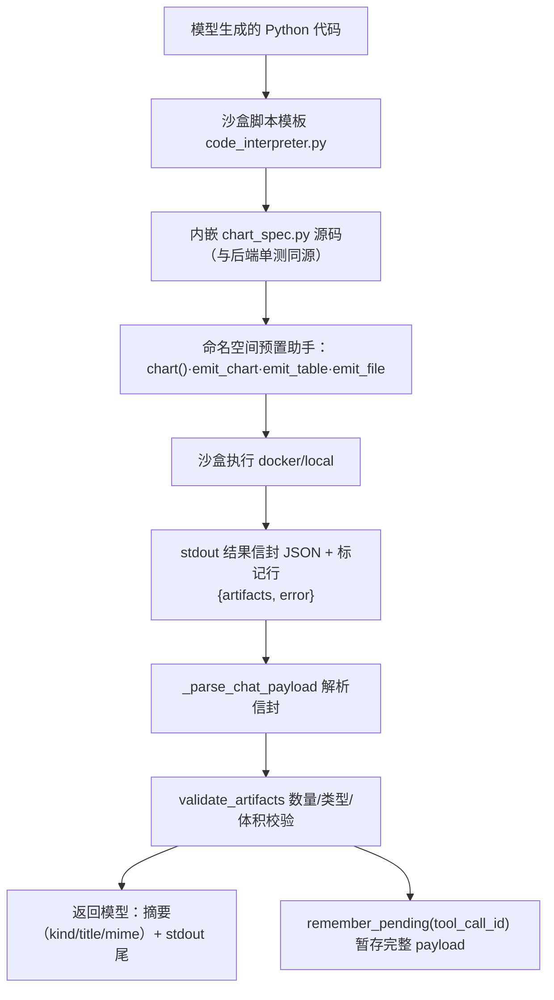
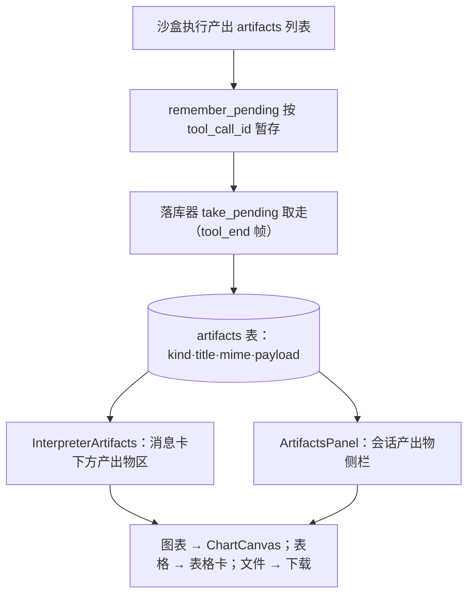
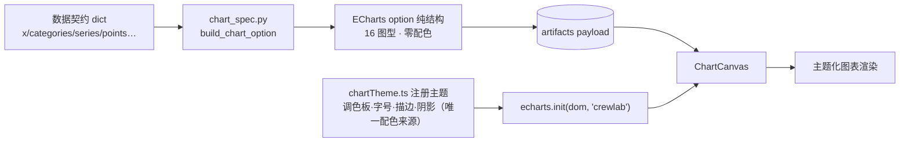

# 产出物与图表架构

run_python 的产出物（图表/表格/文件）走**结构化通道**：执行侧收集、暂存区交接、落库渲染，payload 全程不进模型上下文。图表只有一条生成通道——`chart()` 助手，配色只有一份定义——渲染层主题。

## run_python 执行链路

要点：模型只看到摘要（十几字节），完整 payload（图表 JSON / base64 文件）走暂存区——**这是图表不占 token 的关键**。

## 产出物流向

- 手动运行（无 tool_call_id）不经暂存区，payload 直接进返回值供沙箱页渲染。
- 上限护栏：单次 ≤20 个产出物，单个 ≤5MB，总量 ≤10MB，超限显式报错不静默丢。

## 图表单通道：数据 → 结构 → 主题

- 16 图型：line/area/bar/hbar/stacked_bar/grouped_bar/pie/donut/scatter/radar/gauge/funnel/heatmap/treemap/boxplot/waterfall。
- chart_spec 只出结构（类型、数据、几何、布局、文案模板、显隐），颜色/字号/描边/阴影全部由 chartTheme 注入；结构层零配色有测试守护。
- 数据校验的中文报错（ChartError）直接回给模型让它改数据重试；带单位数值（"80%"）会被拒绝。
- 正文围栏不做任何图表特判：图表只走产出物通道，ECharts JSON 写进正文只会显示为代码块。

## 维护地图（改代码时同步更新）

| 变更 | 改哪里 | 测试 |
|---|---|---|
| 图型/数据契约 | backend/app/tools/chart_spec.py + run_python docstring | tests/test_chart_spec.py |
| 配色/字号 | web/src/lib/chartTheme.ts（只此一处） | 目检主题渲染 |
| 画布行为 | web/src/components/ChartCanvas.tsx | 目检 |
| 产出物护栏 | code_interpreter.py 的 validate_artifacts | tests/test_code_interpreter_tool.py |
