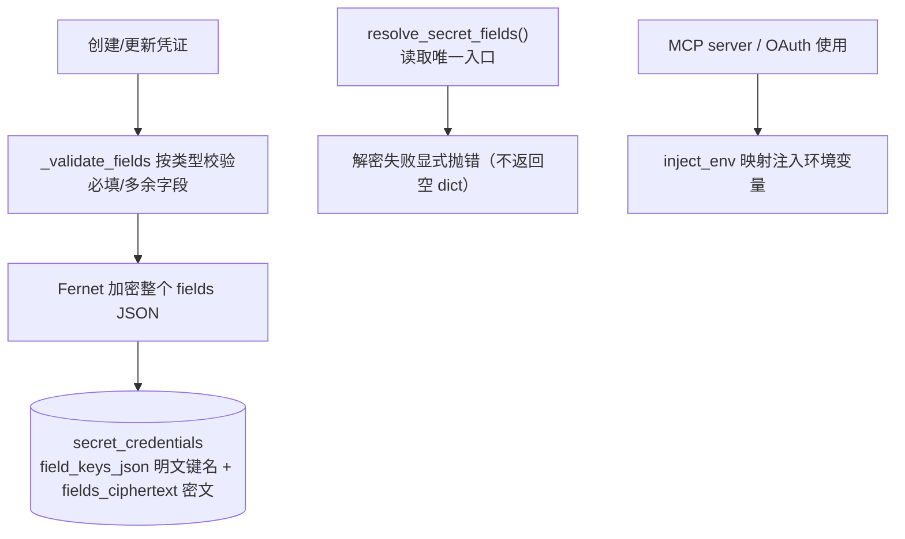
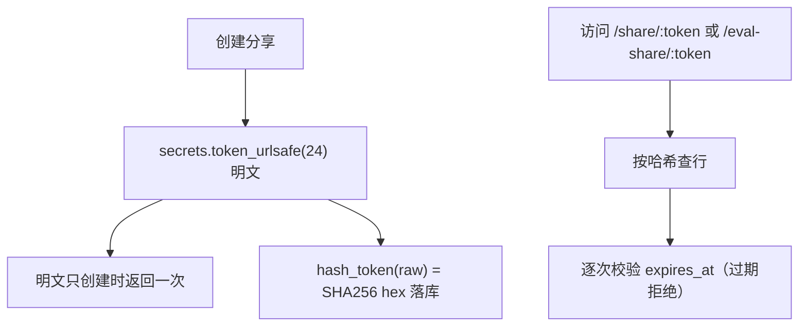

# 凭证与只读分享架构

本文覆盖两类敏感值机制：**凭证保管**（第三方密钥加密存储，供 MCP/OAuth 等使用）与**只读分享**（会话/评测令牌对外只读访问）。共同原则：敏感值只以哈希/密文落库、明文只在创建时返回一次、所有写操作留审计。发布渠道（另一类 Key 机制）见《发布渠道架构》，系统设置见《系统设置与系统时区架构》。

## 凭证保管（secrets_service.py）

**加密密钥**：用独立的 `CREDENTIAL_ENCRYPTION_KEY`（配置名），`_fernet()` = `Fernet(base64.urlsafe_b64encode(sha256(key.encode()).digest()))`。**与登录口令 `AUTH_TOKEN` 解耦**——轮换 AUTH_TOKEN 不会让已存凭证永久不可解（代码注释明确此理由）。

- **存储**：`SecretCredential(name unique, cred_type, description, field_keys_json 明文键名, fields_ciphertext = Fernet(整个 fields JSON))`；`secret_to_wire()` 只暴露 field_keys，永不回传密文/明文。
- **内置类型**：custom / github（token→GITHUB_TOKEN）/ aws / tencentcloud，均带 `inject_env` 映射；`_validate_fields()` 按类型校验必填/多余字段，custom 自由。
- **读取唯一入口 `resolve_secret_fields()`**：解密失败显式抛错（不返回空 dict——避免静默丢凭证）；`encrypt_json/decrypt_json` 复用同源密钥（OAuth token 等）。
- **健康/导出/轮换**：`check_secret()` 能解密即通过；`GET /secrets/health` 逐条解密汇总 broken 数；`GET /secrets/export` 只导 CSV 元数据（密文明文都不出库，审计 `values_exported: False`）；`rotate_secret()` 支持增量轮换（旧密文可解则合并未提交字段），**旧密文不可解时必须一次补全全部字段**，否则拒绝。`list_secret_usage()` 列引用该凭证的 MCP Server。敏感操作均写审计。
- **引用方式**：MCP server 的 `credential` 字段存「凭证名」而非密钥本身（见《MCP全链路架构》），运行时按名取字段并渲染 header 模板。

## 只读分享（share_service.py / eval_share_service.py）

- **会话分享**：`ShareToken` 硬绑 `chat_sessions.id`（CASCADE），过期必填。
- **评测分享**：独立表 `eval_share_tokens` 绑 `eval_runs.run_uid`（避免改既有表结构），`expires_in_hours` 范围 1–720。
- **不撤销**：读时自然过期。`list_shares()` 合并两类（kind=session/eval，status=active/expired），非 admin 只看自己创建的（created_by 可空的历史 eval 行仅 admin 可见）；`revoke_share()` = 删行 + 写审计，仅创建者或管理员。
- `hash_token()` 是单向 SHA256 hex，同款实现被 `api_tokens` / `trigger_rules.webhook_token_hash` 等复用（见《数据模型全景》）。

## 共同设计原则

1. **明文最小化**：凭证密文存储、分享 Key 只返回一次、密文明文都不导出。
2. **不静默降级**：凭证解密失败抛错、分享过期拒绝——不返回「看起来正常」的空值。
3. **写操作留审计**：凭证轮换、分享撤销全部 `write_audit`。

## 维护地图（改代码时同步更新）

| 变更 | 改哪里 |
|---|---|
| 凭证加密/轮换/健康/导出 | services/platform/secrets_service.py、models/secret.py、api/secrets.py |
| 加密密钥配置 | config.py（CREDENTIAL_ENCRYPTION_KEY） |
| 会话分享 | services/chat/share_service.py、models/share.py |
| 评测分享 | services/eval/eval_share_service.py、models/eval_share.py、api/shares.py |
