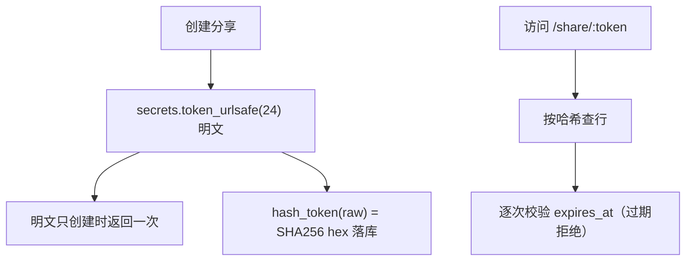

# 凭证/分享/发布与系统设置架构

本文覆盖四个横向能力域：**凭证保管**（第三方密钥加密存储）、**只读分享**（会话/评测令牌）、**发布渠道**（OpenAI 兼容端点）、**系统设置**（通用键值 + 系统时区）。共同设计原则：敏感值只以哈希/密文落库、明文只在创建时返回一次、所有写操作留审计。

## 凭证保管（secrets_service.py）

**加密密钥**：用独立的 `CREDENTIAL_ENCRYPTION_KEY`（配置名），`_fernet()` = `Fernet(base64.urlsafe_b64encode(sha256(key.encode()).digest()))`。**与登录口令 `AUTH_TOKEN` 解耦**——轮换 AUTH_TOKEN 不会让已存凭证永久不可解（代码注释明确此理由）。

> 注意：`secrets_service.py` 模块 docstring 仍写「用 AUTH_TOKEN 派生 Fernet 密钥」，是过时注释；实际行为以 `CREDENTIAL_ENCRYPTION_KEY` 为准。

- **存储**：`SecretCredential(name unique, cred_type, description, field_keys_json 明文键名, fields_ciphertext = Fernet(整个 fields JSON))`；`secret_to_wire()` 只暴露 field_keys，永不回传密文/明文。
- **内置类型**：custom / github（token→GITHUB_TOKEN）/ aws / tencentcloud，均带 `inject_env` 映射；`_validate_fields()` 按类型校验必填/多余字段，custom 自由。
- **读取唯一入口 `resolve_secret_fields()`**：解密失败显式抛错（不返回空 dict——避免静默丢凭证）；`encrypt_json/decrypt_json` 复用同源密钥（OAuth token 等）。
- **健康/导出/轮换**：`check_secret()` 能解密即通过；`GET /secrets/health` 逐条解密汇总 broken 数；`GET /secrets/export` 只导 CSV 元数据（密文明文都不出库，审计 `values_exported: False`）；`rotate_secret()` 支持增量轮换（旧密文可解则合并未提交字段），**旧密文不可解时必须一次补全全部字段**，否则拒绝。`list_secret_usage()` 列引用该凭证的 MCP Server。敏感操作均写审计。

## 只读分享（share_service.py / eval_share_service.py）

- **会话分享**：`ShareToken` 硬绑 `chat_sessions.id`（CASCADE），过期必填。
- **评测分享**：独立表 `eval_share_tokens` 绑 `eval_runs.run_uid`（避免改既有表结构），`expires_in_hours` 范围 1–720。
- **不撤销**：读时自然过期。`list_shares()` 合并两类（kind=session/eval，status=active/expired），非 admin 只看自己创建的（created_by 可空的历史 eval 行仅 admin 可见）；`revoke_share()` = 删行 + 写审计，仅创建者或管理员。

## 发布渠道（publish_service.py / api/publish.py）

**一个渠道 = 一把 Key + 一个助理 + 一个持久会话**（`PublishedChannel`：name unique 且兼作 `observation_turns.channel` 记账键、agent_id、provider/model、key_hash、key_prefix、session_id、expires_at、enabled）。

- **Key 签发/鉴权**：`_issue_key()` = `"pk-" + token_urlsafe(32)`，返回 (原文, sha256, 前 12 位掩码)；原文仅创建/轮换响应出现一次。`resolve_channel()` 校验 `pk-` 前缀 + 哈希命中 + enabled + 未过期，失败 `ChannelAuthError`。公开端点 `require_channel()` 读 `Authorization: Bearer pk-…`，失败统一 401（带 `WWW-Authenticate: Bearer`）。
- **会话复用**：`ensure_session()` 复用 `channel.session_id`，会话被删则重建并回写；**锁内先 `db.refresh(channel)` 重读**，避免并发下用旧快照重复建会话；`create_session(user_id="channel:{id}", owner_user_id=created_by, ...)`。
- **串行化**：`channel_lock(channel_id)` = `RedisLock("channel:{id}", ttl_ms=600_000)`（见《Redis强依赖与多worker协同架构》）。理由：共用 ADK 会话，并发会撞 stale session。
- **改名**：`update_channel()` 改 name 会批量更新历史 `observation_turns.channel` 和会话标题，否则用量统计断档；换 provider/model 会清空 session_id（模型固化在会话里）。
- **公开端点**：`POST /v1/chat/completions`、`GET /v1/models`。`_validate_completion_request()` 显式拒绝不支持参数（tools / functions / response_format / max_tokens / 非默认 temperature 等一律 400），`model` 必须等于渠道模型（否则 404）。`_frames()` 调 `chat_service.stream_session_message(..., channel=channel.name, thinking_enabled=False, web_search_enabled=False)`，**只把 `assistant_delta` 转 OpenAI chunk**，审批/工具/思考帧不外泄；审批帧转成 `upstream_error`；流式支持 `stream_options.include_usage`，结束 `[DONE]`；非流式失败 502。
- 管理端 `/publish/channels*` CRUD/rotate（require_admin）+ 审计。

## 系统设置（app_settings_service.py / api/system_settings.py）

- **存储**：`AppSetting(key=="{category}.{key}", value)`；支持类目 `agent / observability / knowledge / usage`。
- **系统时区**：键 `observability.timezone`，`SYSTEM_TIMEZONES` 是固定偏移表（UTC / UTC+05:30 / UTC+08:00 / UTC+09:00 / UTC-05:00 / UTC-08:00），默认 `UTC+08:00`；固定偏移而非 IANA 时区库，避免依赖系统 tzdata。`get_system_timezone()` 返回 (配置名, tzinfo)，缺配置/非法显式失败；被 `usage_service._day_expr()` 用于切日界。
- **校验**：`put_setting()` 按类目白名单 + 值校验（chunk_size≥64、overlap≥0、rrf_min_score 有限非负、daily_token_soft_limit 空=不限否则≥1、llm_timeout 30..900、output_locale ∈ {"",zh,en} 等）；`sensitive=true` 直接拒绝（通用设置不允许敏感值）。
- **reveal 脱敏**：`GET /system-settings/export` 对 sensitive 项输出 `MASK`；`GET /system-settings/{category}/{key}/reveal` 走 `llm_admin.reveal_api_key(db, provider_id)` 返回真实值并写审计 `setting.reveal`。

## 共同设计原则

1. **明文最小化**：凭证密文存储、分享/发布 Key 只返回一次、密文/明文都不导出。
2. **不静默降级**：凭证解密失败抛错、时区缺失抛错、渠道鉴权失败 401——不返回「看起来正常」的空值。
3. **写操作留审计**：凭证轮换、分享撤销、渠道 CRD、设置 reveal 全部 `write_audit`。

## 维护地图（改代码时同步更新）

| 变更 | 改哪里 |
|---|---|
| 凭证加密/轮换/健康/导出 | `services/platform/secrets_service.py`、`models/secret.py`、`api/secrets.py` |
| 分享机制 | `services/chat/share_service.py`、`services/eval/eval_share_service.py`、`api/shares.py` |
| 发布渠道/OpenAI 端点 | `services/chat/publish_service.py`、`api/publish.py` |
| 系统设置/时区 | `services/platform/app_settings_service.py`、`api/system_settings.py` |
