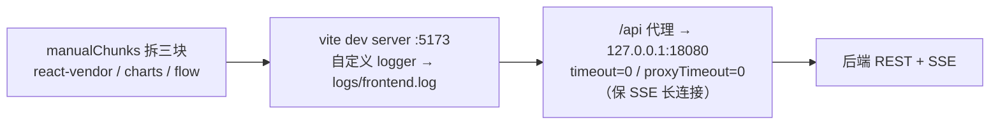
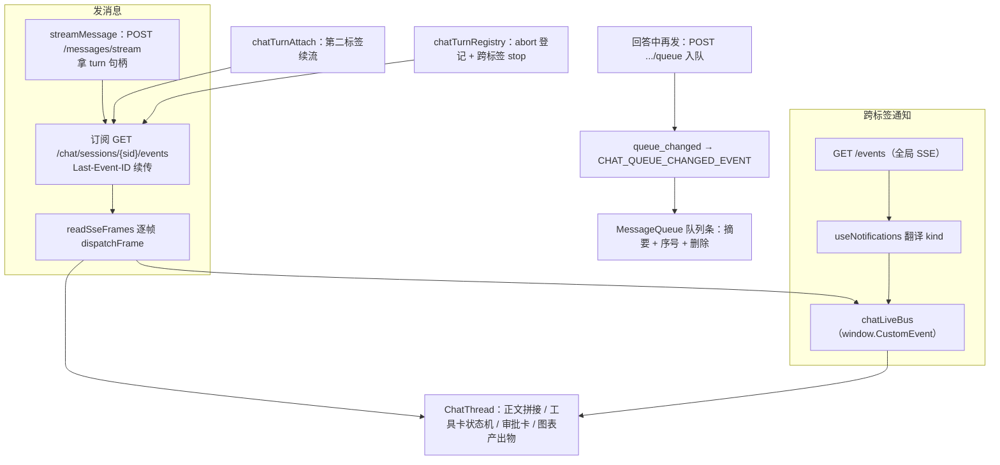

# 前端架构

前端是 React 18 + Vite 的单页应用，通过 REST + SSE 与后端交互。核心设计：**所有流式接口统一用 `fetch + readSseFrames` 手写解析（不用 EventSource，因为它带不上 Authorization）**；跨标签实时靠全局 SSE 通知 + `window.CustomEvent` 桥接，页面轮询降级为兜底。

## 技术栈与构建

| 能力 | 选型 |
|---|---|
| 框架 / 路由 | React 18.3 + react-router-dom 6.27 |
| 状态 | zustand 5（persist 中间件） |
| 组件 / 样式 | @base-ui/react + Tailwind 3.4 |
| 图表 / 可视化 | echarts 6 + recharts 2.13 |
| 画布 / 图 | @xyflow/react 12 + dagre + mermaid 12 |
| 表格 / 拖拽 | @tanstack/react-table 8 + dnd-kit |
| 测试 | vitest 1.6 + MSW + Playwright |

- Vite 显式绑 IPv4（避免只听 `::1` 导致 `127.0.0.1:5173` 连不上）。
- `/api` 代理 `timeout=0` / `proxyTimeout=0`，否则 SSE 长连接会被代理超时切断。
- 全站字体只保留 sans（`tailwind.config.ts` 不生成等宽工具类）——中文与英文混排不出现异形字形；code/kbd/pre/samp 同样用 sans（UI 规范在仓库 docs/UI设计规范.md，不在本知识库语料内）。

## 路由与守卫（App.tsx）

- 约 38 个页面用 `lazy()` 动态导入，单个 `<Suspense>` 兜底。
- 守卫：`RequireAuth`（登录，内挂 `useNotifications`）/ `PublicOnly`（未登录可访问）。
- 公开路由：`/login`、`/share/:token`、`/eval-share/:token`。
- settings 为嵌套路由；主区路由覆盖 Chat / Knowledge / Workflows / Approval / Agents / MCP / Skills / Tools / Eval / Observability / Sandbox / Publish 等。

## 状态层（src/store/）

| store | 职责 |
|---|---|
| `auth.ts` | persist `ongrid.auth` + `getToken()`（client 注入 Authorization） |
| `me.ts` | `loadMe` single-flight + `useMe` + `usePermissions`（角色门槛） |
| `chatSessions.ts` / `chatPrefs.ts` | 会话列表、对话偏好 |
| `modelSelection.ts` | 模型选择（含单测） |
| `theme.ts` / `mode.ts` / `ui.ts` / `systemTimezone.ts` | 主题、模式、UI、系统时区 |

`auth` 与 `me` 分离：`getToken` 供 API 层同步取 token，`useMe` 供组件读用户信息与权限。

## API 客户端（src/api/client.ts）

- `BASE = '/api/v1'`；`request()` 统一注入 `Authorization: Bearer <token>`（从 `getToken()` 取）。
- 401 且非 `noAuth` 时直接登出（单管理员固定 token、无 refresh，401 即会话失效）。
- 统一 `ApiError`（message / status / code / detail body）。
- 导出类接口返回文件流：单独 `fetch` + 统一 `ApiError` 抛错，保证错误体验一致。
- `api/sse.ts`：`SseFrame { event, data, id? }` + `parseSseFrame` / `readSseFrames`。手写解析支持分帧、跨块拼半帧、CRLF 归一化、流末残帧、回调返回 false 停止、非成功状态抛 `ApiError`；`id` 行供 `Last-Event-ID` 续传。

## 实时通信全链路

这是前端最关键的设计——**统一 `fetch + readSseFrames`，不用 EventSource**（EventSource 无法携带 Authorization 头）。

**发送按钮三态**（`ChatInput.tsx`，busy=submitting 时）：
- **空闲**：`➤ 发送`，走原 `send`，行为不变。
- **回答中**：主按钮变 `＋ 排队发送`（仍可点），走 `onQueue` → 上传附件后调 queue API，**不打断当前回合**；旁边出现次级 `⚡ 插话 · 即将上线`（disabled 占位）。输入框/模型/思考/联网开关/附件按钮保持可编辑。回答中按 Enter 也走排队分支；Esc 停止不变。
- **真只读态**：`execBusy`（计划/排查执行锁）仍走 `disabled` 整体禁用，与三态无关。
- **附件**：`ChatInput` 放行 zip（mime 或 `.zip` 扩展名兜底），单包 ≤32MB，图片仍 5MB/最多 4 张/合计 20MB，zip 独立计额不占图片额度。

**关键 lib**：

- `chatLiveBus.ts`：`window.CustomEvent`，9 种 detail——`busy` / `exec` / `thinking_delta` / `assistant_delta` / `tool_start` / `tool_end` / `approval_pending` / `approval_decided` / `graph_created`。单标签内的帧回灌走这里。
- `useNotifications.ts`：把后端 `NotificationKind` 翻译成既有 window 事件——`chat_refetch` / `graph_finished` → `requestChatRefetch` + chatLiveBus；`approval_decided` → chatLiveBus；`graph_created` → 工作台切到新图；`knowledge_sync_done` / `eval_run_done` → 对应 window 事件；`queue_changed` → `CHAT_QUEUE_CHANGED_EVENT`（detail 带 payload，ChatThread 按 session_id 过滤后重拉队列）。**页面复用原有处理逻辑**，不另写一套。
- `chatTurnAttach.ts`（第二标签续流）+ `chatTurnRegistry.ts`（abort 登记、跨标签 stop）：把「另一标签点停止」传播到生产者。
- `subscribeNotifications`（`api/notifications.ts`）：指数退避重连 1s→30s。

## 页面刷新策略（事件 + 兜底轮询）

| 页面 | 主刷新 | 兜底轮询 |
|---|---|---|
| ChatThread | SSE 帧 + 通知事件（含 queue_changed） | 30s，指纹去重 |
| ApprovalDetail | 精确 `approval_decided` | 30s |
| KnowledgeSources | `knowledge_sync_done` | 5s |
| EvalDataset | `eval_run_done` | 5s |

通知只带信号，页面收到后重拉权威数据（见《Redis强依赖与多worker协同架构》阶段4）。

## UI 组件与国际化

- `components/ui/` barrel 汇总基础组件；语义令牌支持 light/dark 主题。
- 国际化用内联 `tr(zh, en)`（双语字符串），无独立 i18n 框架。
- 图表主题 `chartTheme.ts` 统一 echarts/recharts 配色，与 UI 主题联动。
- 图表锚点 `chartAnchors.ts` 把正文里的图表引用定位到产出物面板（见《产出物与图表架构》）。

## 测试基础

- `setup.ts` 补 `PointerEvent` / `localStorage` / `ResizeObserver` / `DOMMatrixReadOnly` 等 jsdom 缺失能力。
- MSW `onUnhandledRequest: 'error'`——未声明的请求直接失败，避免测试假通过。
- `fetch-jsdom-environment.ts` 让 fetch 在 jsdom 下可用。
- 只跑相关 vitest，禁全量。

## 维护地图（改代码时同步更新）

| 变更 | 改哪里 |
|---|---|
| SSE 解析 | `api/sse.ts` + `api/sse.test.ts` |
| API 鉴权/错误 | `api/client.ts` + `store/auth.ts` |
| 实时事件种类 | `lib/chatLiveBus.ts` + `lib/useNotifications.ts`（含 `queue_changed` → `CHAT_QUEUE_CHANGED_EVENT`） |
| 回答中排队 | `api/chat.ts`（`addQueueItem`/`getQueue`/`deleteQueueItem`）、`components/MessageQueue.tsx`、`components/ChatInput.tsx`（三态 + zip）、`pages/ChatThread.tsx`（`enqueue`/`removeQueueItem`） |
| 通知重连/续流 | `api/notifications.ts`、`lib/chatTurnAttach.ts`、`lib/chatTurnRegistry.ts` |
| 代理/SSE 超时 | `vite.config.ts` |
| 路由/守卫 | `App.tsx` |
