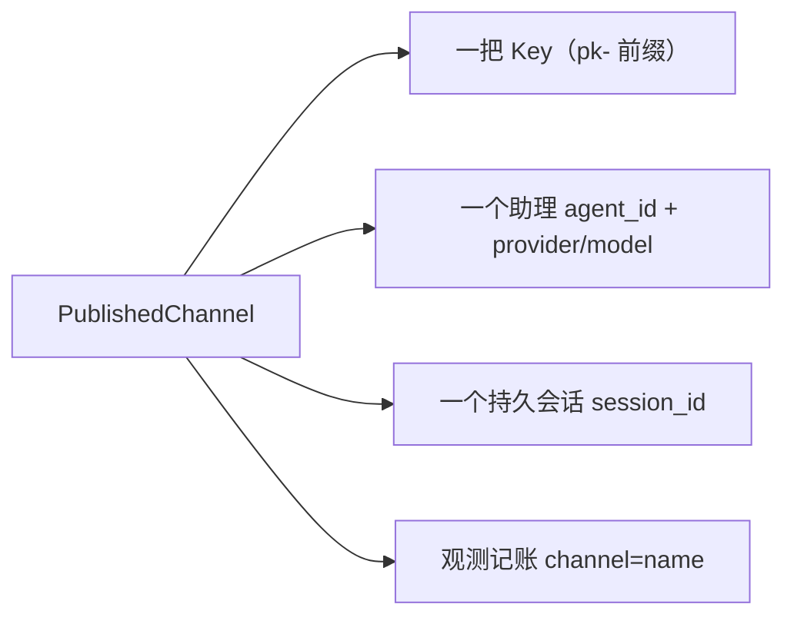
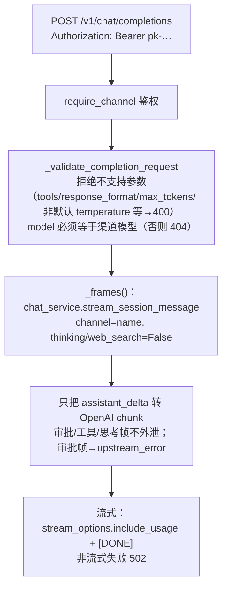

# 发布渠道架构

发布渠道把平台里的一个助理包装成 OpenAI 兼容的 HTTP 服务对外提供：**一个渠道 = 一把 Key + 一个助理 + 一个持久会话**。渠道名同时是 `observation_turns.channel` 的记账键，用量可按渠道拆分（见《沙盒与可观测架构》）。会话复用靠 Redis 锁跨 worker 串行，避免并发撞 stale session（见《ADK会话与状态管理架构》《Redis强依赖与多worker协同架构》）。

## 渠道模型（models/channel.py）

`PublishedChannel` 字段：name（unique，兼作观测 channel 记账键）、agent_id、provider/model、key_hash（`hash_token` = sha256）、key_prefix（掩码）、session_id、expires_at（NULL=永不过期）、enabled。

## Key 签发与鉴权（publish_service.py）

- `_issue_key()` = `"pk-" + secrets.token_urlsafe(32)`，返回 (原文, sha256, 前 12 位掩码)；**原文仅创建/轮换响应出现一次**。
- `resolve_channel()` 校验 `pk-` 前缀 + 哈希命中 + enabled + 未过期，失败 `ChannelAuthError`。
- 公开端点 `require_channel()` 读 `Authorization: Bearer pk-…`，失败统一 401（带 `WWW-Authenticate: Bearer`）。
- `rotate_key()` 换哈希；管理端 `/publish/channels*` CRUD/rotate（require_admin）+ 审计。

## 会话复用与串行化

- `ensure_session()` 复用 `channel.session_id`，会话被删则重建并回写；**锁内先 `db.refresh(channel)` 重读**，避免并发下用旧快照重复建会话；`create_session(user_id="channel:{id}", owner_user_id=created_by, title="[发布] {name}")`。
- `channel_lock(channel_id)` = `RedisLock("channel:{id}", ttl_ms=600_000)`（Redis SET NX PX + Lua 校验值释放，跨 worker 串行）。理由：共用 ADK 会话，并发会撞 stale session。
- **改名**：`update_channel()` 改 name 会批量更新历史 `observation_turns.channel` 和会话标题，否则用量统计断档；换 provider/model 会清空 session_id（模型固化在会话里）。

## OpenAI 兼容端点（api/publish.py）

公开端点：`POST /v1/chat/completions`、`GET /v1/models`。

- **帧过滤**：只输出 `assistant_delta`；审批帧转成 `upstream_error`——避免把内部审批/工具细节泄露给外部调用方。
- `GET /v1/models` 返回该渠道对应的模型。

## 设计要点

1. **Key 明文只一次**：签发/轮换响应返回原文，库里只有哈希 + 掩码。
2. **串行化是正确性前提**：共用会话下，Redis 锁保证跨 worker 不撞 stale session。
3. **改名要维护观测连续性**：批量回填历史 channel，避免用量断档。

## 维护地图（改代码时同步更新）

| 变更 | 改哪里 |
|---|---|
| 渠道模型 | models/channel.py |
| Key 签发/鉴权/会话复用/锁 | services/chat/publish_service.py（_issue_key / resolve_channel / ensure_session / channel_lock） |
| OpenAI 端点/帧过滤 | api/publish.py（_frames / _validate_completion_request） |
| 用量记账口径 | services/observability/usage_service.py（channel 维度） |
