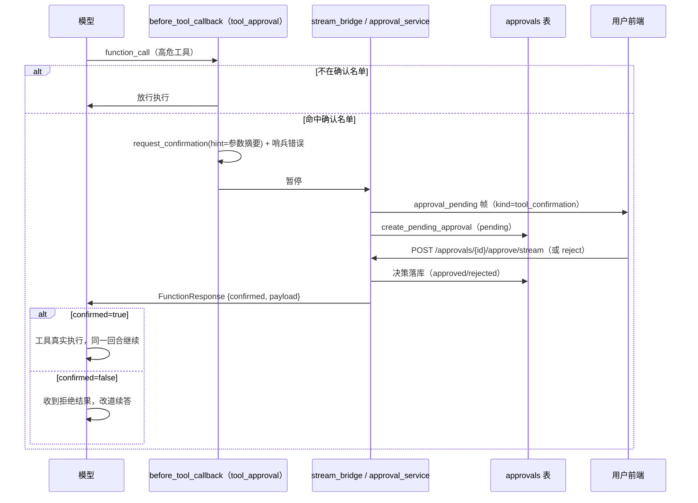
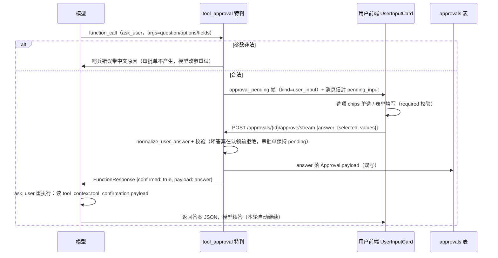

# 审批与澄清交互

两类产品交互共用同一条「暂停—决策—恢复」骨架：**高危工具确认**（approve/reject）与 **ask_user 澄清**（选项/表单作答）。机制上都是 before_tool_callback 拦截 + 哨兵暂停 + FunctionResponse 回灌。

> **机制共用，呈现不混用**：「操作确认」是审批——批准/拒绝、进批量；「需要输入」是澄清提问——去会话里作答或跳过，不进批量。会话列表分开计数（待审 / 待输入），待确认页的动作与徽标按 kind 分开。待确认页展示失效时间与剩余倒计时（失效 = created_at + `knowledge.approval_timeout_hours`，到点未决标 expired，绝不自动批准）。
>
> **会话级免审**：审批卡的「批准并执行」是拆分按钮——主按钮仅本次批准；下拉两项「批准并在本会话中信任此工具」「批准并在本会话中信任所有工具」，批准时经 ToolConfirmation.payload 把免审范围（`tool`/`all`）送进闸门，置 ADK 会话状态 `skip_tool_approvals`（`"all"` = 全部工具免审；工具名单 = 仅名单内免审），本会话后续命中免审范围的调用直接放行（随会话持久化）；澄清提问不受影响，照常询问。

## 审批暂停—恢复时序

## ask_user 澄清的数据流

## 关键设计点

| 设计 | 原因 |
|---|---|
| 答案经 FunctionResponse 与 DB 双写，工具只信确认载荷/DB | 回放与恢复一致性，防帧丢失 |
| 坏答案在认领审批前拒绝 | 消耗掉 pending 审批就无法重试 |
| ask_user 特判先于确认名单 | 澄清不是「确认执行」，语义不同但骨架复用 |
| 子 Agent 不装配 ask_user | 被委派任务里无人可答，按最合理假设继续并注明 |
| 暂停信封落消息 | 历史回放能重渲染澄清卡并显示「你的回答」 |

## 涉及文件

- 后端：adk_runtime/tool_approval.py、adk_runtime/stream_bridge.py（approval_pending/FunctionResponse）、tools/user_input.py、services/chat/approval_service.py、api/approvals.py。
- 前端：MessageBubble 的 PendingApprovalCard / UserInputCard、api/approvals.ts（streamApproveApproval 携带 answer）、ChatThread 的 onApprovalPending 分支。
- 测试：tests/test_ask_user.py（真实会话暂停—作答—续跑）、MessageBubble.test.tsx（卡片渲染与提交）。
