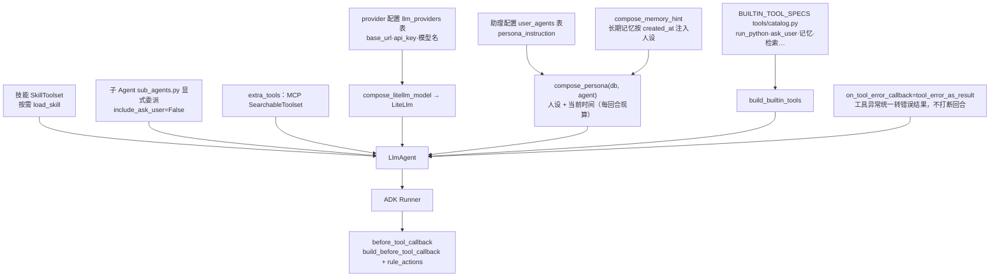
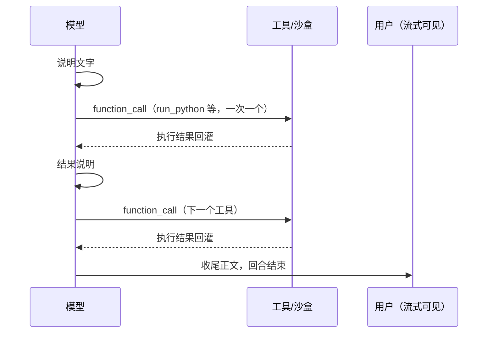
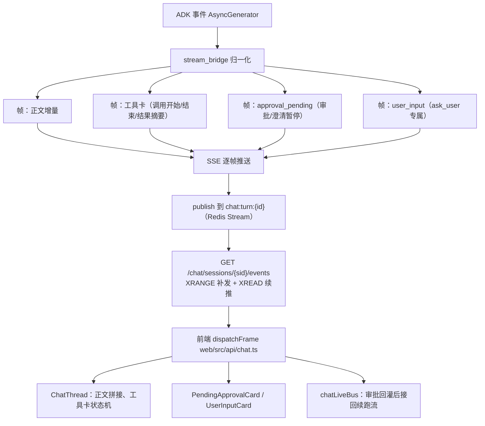
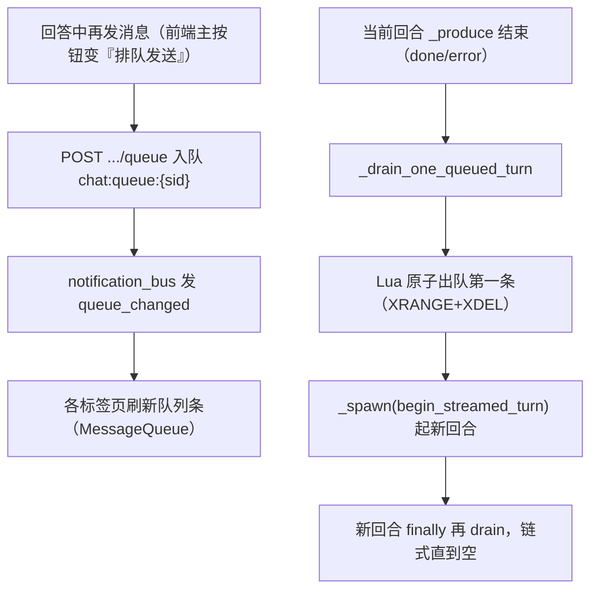
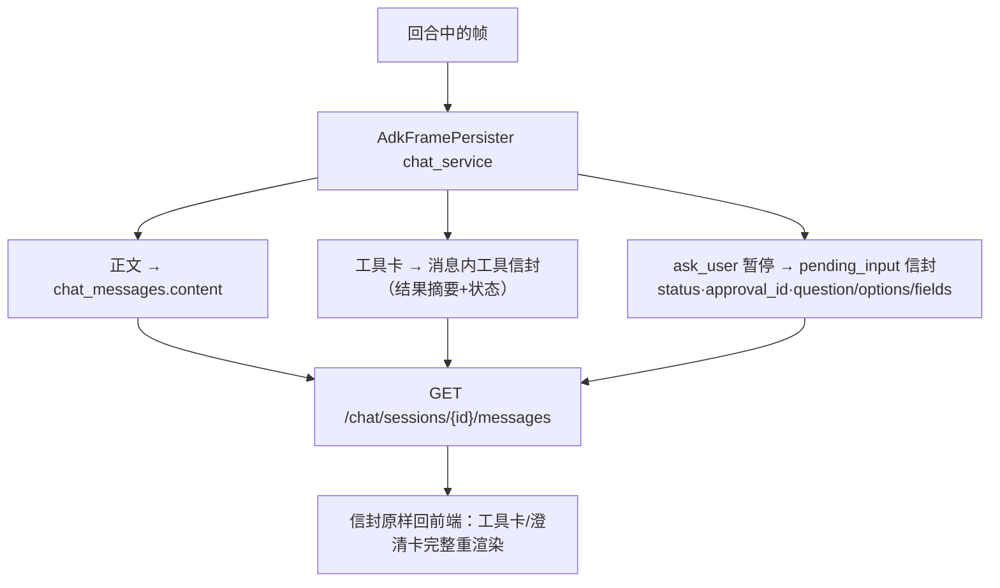

# 对话与智能体架构

对话链路围绕 ADK 的 LlmAgent 装配与流式事件桥接展开：产品侧只做编排与持久化，推理循环完全交给 ADK。装配全貌见《Agent装配与子代理架构》，本文聚焦一次消息从输入到帧流/落库的具体链路。

> Redis 改造后，帧生产与 HTTP 连接解耦：`POST /messages/stream` 立即返回 turn 句柄，后台任务消费 runner、落库、推流到 `chat:turn:{turn_id}`；各标签页从 `GET /chat/sessions/{sid}/events` 补发 + 续推（见《Redis强依赖与多worker协同架构》）。下文「流式管线」按此模型理解。

## 装配流程（adk_runtime/agent_factory.py）

要点：

- 工具目录定义名称/分组/风险/装配时机（mount=always 随会话装配；per_turn 由对话开关决定，如联网搜索）。
- **SkillToolset 用 EAGER 发现**：目录（名称+描述）随会话装配可见，正文靠 `load_skill` 按需加载，避免无差别 `list_skills`（见《Skill架构》）。
- **rule_actions**：审批规则的命中动作在装配期改写确认/禁用名单（`build_agent_tool_bundle` → `apply_rule_actions`），闸门只执行装配好的名单（见《工具执行权限与审批规则》）。
- **tool_error_as_result**：注册在装配入口，统一兜底非 MCP 工具异常（ADK 默认只兜 MCP），覆盖对话、子代理与排查 worker——这是「从根因统一处理」的典型先例，不逐个包工具函数。
- **无人值守路径**：任务图节点/汇总走 `services/execution/agent_assembly.assemble_agent`（只读闸门 + 工具聚焦），不经过对话的 ask_user 路径，但复用同一装配与错误兜底（见《Agent装配与子代理架构》）。
- include_ask_user=False 用于子 Agent：澄清提问只在与用户直接对话的根 Agent 上。
- max_turns 装配期校验（0 不限），实际限轮由 Runner 的 RunConfig.max_llm_calls 生效。
- 模型前缀与厂商专属请求体由 provider 配置决定，不强加 openai/ 前缀或某家 thinking 字段；`apply_thinking_extra` 同时注入 DashScope `thinking` 与 OpenAI `reasoning_effort` 两种形态。

## 提示词的三块来源

1. **CHAT_AGENT_INSTRUCTION**（全局纪律）
   - 多工具节奏：「说明 → 调用 → 结果说明 → 下一说明 → 下一调用」，禁止连发后补写。
   - 澄清规则（最高优先级）：缺工具必填实参/需用户选择或补充信息时调 ask_user，禁止占位符先调用；一句话能问清才允许纯文本提问（此时 function call 数必须为 0）。
   - 图表规则：一律 run_python 的 chart() 产出物，正文禁写 ECharts 配置或图表 JSON。
2. **compose_persona**（agent_service）：助理人设 + `## 当前时间`（本地时间 + 时区标签 + 星期，每回合现算；chat / 审批恢复 / playground / 子助理四路汇合点）。
3. **工具返回值**：检索结果、代码输出等走工具通道，不人工拼进提示词。

## 一回合多工具的推进节奏

被审批/澄清拦截时，回合在工具调用处暂停（见《审批与澄清交互》），用户决策后续跑，同一回合继续上述节奏。

## 流式管线（adk_runtime/stream_bridge.py）

> 帧的生产者只有一个（后台任务），它同时负责落库与 publish；多个订阅者只读流，不重复落库。连接断开不影响生产，第二标签页可补发进行中回合。

## 回答中排队消息（插话/消息队列）

回答还在生成时用户再发的消息默认**排队**（可多条、可删除），当前回合结束后服务端按入队顺序依次消费，形成链式回合直到队列空。入队是独立端点，不打断当前回合。

- 队列是临时缓冲：Redis Stream `chat:queue:{sid}`，Stream ID 即 item_id，每次操作续 24h TTL；权威数据仍是落库的 chat_messages，队列只缓冲「起回合所需参数」（正文/模型/开关/附件 id/mentions/owner）。
- **原子出队**用 Lua 一次完成读第一条 + XDEL，多 worker 不会重复消费；空正文脏项出队后跳过继续取（不死循环）。
- 出队消费先发 `queue_changed(dequeued)` 再起新回合；放在本回合 `chat_refetch` 通知之后，保证前端先收到本回合落库信号。
- `models/chat.py` 的 `ChatMessage.interrupted` 字段是插话打断写入的标记位（本阶段默认 False，供后续打断阶段使用；表结构变更由 `scripts/add_chat_message_interrupted.py` 一次性补列）。
- 三段端点：`POST .../queue`（入队）、`GET .../queue`（列表）、`DELETE .../queue/{item_id}`（删除）；实现见 `services/chat/chat_queue.py`。细节见《Redis强依赖与多worker协同架构》。

## 持久化与回放

- 会话双轨：chat_sessions（业务侧）+ ADK sessions（Runner 状态，含 user_states/app_states 运行态）。
- 消息全量落 chat_messages——这也是「消息发送不进审计」的前提（已有完整事实源）。

## 纪律

- 禁止 mock：链路测试走真实 ADK + 真实沙盒 + 真 Redis（见 AGENTS.md 测试纪律）。
- 新增帧类型必须同时改四处：stream_bridge → 前端 dispatchFrame → 持久化信封 → 回放渲染；帧分发走 Redis Stream，语义不变。

## 维护地图（改代码时同步更新）

| 变更 | 改哪里 |
|---|---|
| 装配/回调/错误兜底 | `adk_runtime/agent_factory.py`（三工厂、`tool_error_as_result`） |
| 提示词纪律 | `CHAT_AGENT_INSTRUCTION`、`agent_service.compose_persona`、`compose_memory_hint` |
| 帧语义/归一化 | `adk_runtime/stream_bridge.py` |
| 帧分发/续传 | `services/chat/chat_stream_bus.py`、`web/src/api/sse.ts` |
| 排队消息 | `services/chat/chat_queue.py`、`api/chat.py`（三个 queue 端点）、`chat_stream_orchestrator._drain_one_queued_turn`、`web/src/components/MessageQueue.tsx` |
| 落库/回放 | `chat_service.AdkFramePersister`、`api/chat.py`、`models/chat.py`（`interrupted`） |
