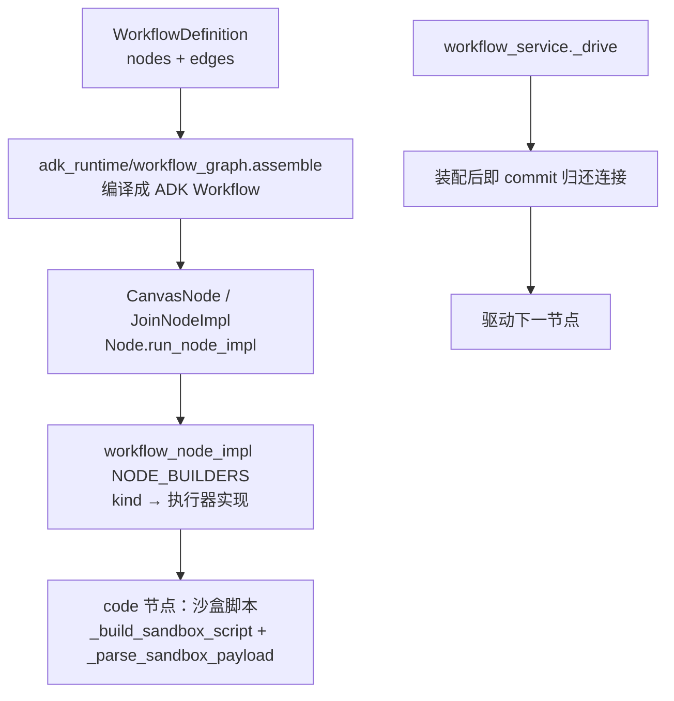
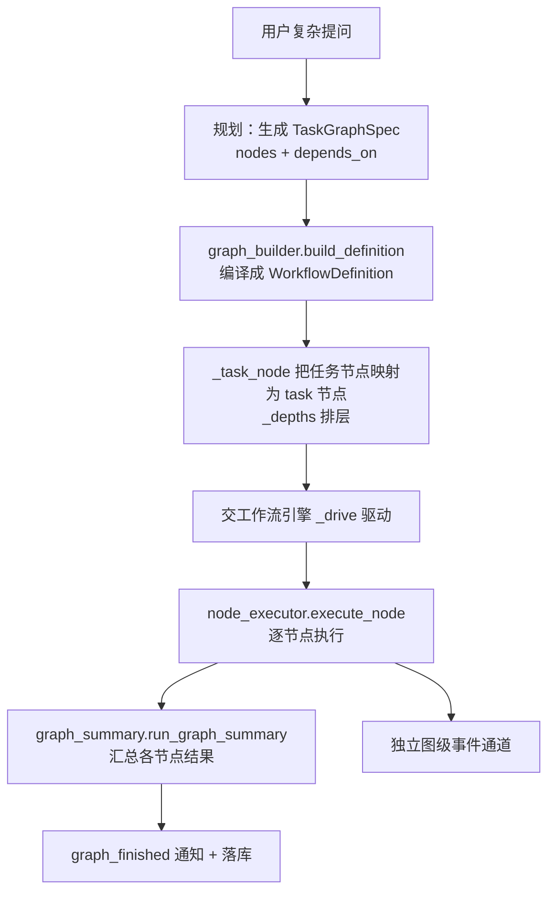

# 工作流与任务图架构

平台有两套编排能力：**工作流（Workflow）**是可复用的 DAG 定义与运行引擎；**任务图（TaskGraph）**是「一次复杂提问」的规划—执行编排。二者不是两套引擎——任务图会编译成工作流 DAG，由同一个工作流引擎驱动，只是外面套了一层系统运行壳（规划、节点执行、汇总、独立事件通道）。

## 工作流引擎（services/workflow/）

### 定义与运行分离

`workflows`（定义）与 `workflow_runs` / `node_runs`（运行）分表。定义是静态 DAG，运行是每次执行实例。

### 节点类型（schemas/workflow.py NodeKind）

15 种节点，按 4 组展示（前端节点库顺序）：

| 组 | 节点 |
|---|---|
| 编排 flow | `start` `end` `join` `switch` `loop` |
| 模型 model | `agent` |
| 工具与动作 action | `task` `knowledge` `search` `mcp` `http` `code` `assign` |
| 人工协同 human | `approval` `input` |

每类节点有严格校验（`WorkflowDefinition.validate`）：`task` 节点特有 task 配置（非 task 节点禁带）；`agent` 必须有 provider/model/instruction；`mcp` 节点必须指定 mcp_server 与 mcp_tool；`start`/`end`/`join` 的连边规则（如 join 节点不允许带 route、`switch` 节点分支校验）也在这一层校验。

### 编译与执行

- `workflow_service`：`definition_for` / `initial_state` / `create_run` / `_drive`（**装配后即 commit 归还连接**，避免长事务持锁）/ `execute_existing_run` / `resume_run`。
- `workflow_runner.start_run` 先 `begin_run` 再进入引擎。
- `CanvasNode.run_node_impl` 是画布节点执行入口；`JoinNodeImpl` 实现屏障（`_requires_all_predecessors`——等所有前驱到齐）。
- `workflow_node_impl` 的 `NODE_BUILDERS` 把 kind 映射到执行器；`code` 节点在沙盒跑脚本（`_build_sandbox_script` 注入 state、`_parse_sandbox_payload` / `_parse_sandbox_reads` 解析输出），state 用受控镜像类（`_StateView`）禁止越界写。
- 运行可停止（`run_control`）、节点可挂审批、节点可试跑。画布工具节点与内置工具目录同源（见《内置工具与技能说明》）。

### 触发器（trigger）

`trigger_rules` 由调度循环按 cron 计算下次触发时刻，产生 `trigger_runs`。调度循环用 `LeaderLease` 保证多 worker 单实例（见《Redis强依赖与多worker协同架构》）。

## 任务图（services/taskgraph/）：规划—执行—汇总

任务图面向「一次复杂提问」：先规划出 DAG，再逐节点执行，最后汇总。

### 编译规则（graph_builder.py）

- `build_definition(spec)` 把 `TaskGraphSpec` 转成 `WorkflowDefinition`：`_depths(spec)` 按依赖算层级，`_task_node` 把每个任务映射成工作流 `task` 节点，依赖转成边。
- `display_template()` 提供前端展示模板。
- 任务图 = **编译成工作流 DAG + 系统运行壳 + 注入 task_runner + 独立图级状态/汇总/事件通道**。

### 单节点执行四步（node_executor.py）

`execute_node(graph_uid, node_uid, budget, publish, runtime)`:

1. **入口闸**：新开 `SessionLocal` 会话，校验图存在、`runtime.stop_requested` 未停、节点状态为 pending/queued；置 `running` + `started_at` 并提交；发 `node_started` 事件。
2. **停止注册**：`await runtime.stop.begin(node_uid)`，定义同步 `_stop_check`（`stop.is_stopped(uid) or runtime.stop_requested`）交给 worker。
3. **装配 + 执行**：`assemble_agent`（无人值守装配，含只读闸门与工具聚焦，见《Agent装配与子代理架构》），`build_node_prompt` 拼 question/target/instruction/prior_context（prior_context 由 `_build_prior_context` 取前序节点结果）；`_on_tool_response` 把工具结果落 artifact。
4. **收尾**：写节点结果状态、耗时，发终态事件。

> 关键：批量节点失败/停止不抛异常打断整图——单节点 error 记为节点状态，图继续或按停止信号终止。

### 系统运行壳（task_graph_service.py）

`_GraphRuntime` 是 Redis-backed 的图级运行状态（见《Redis强依赖与多worker协同架构》）：

- `stop_requested` 走共享标志；`running` 走 Redis Hash；`node_uids` 走 Redis Set。
- 刷新锁 `_refresh_lock` 用 `RedisLock`，跨 worker 串行。
- 图级事件 `graph_created` / `node_started` / `node_finished` / `graph_finished` 发到独立 Stream；`graph_finished` 经 `notification_bus` 通知前端。

### 汇总（graph_summary.py）

`run_graph_summary` 用 `build_summary_prompt(question, nodes)` 让模型基于各节点结果生成最终回答；汇总本身也是一次无人值守 agent 调用。

## SSE 事件端点

- 工作流事件：`api/workflows.py` 的 SSE 端点读 `workflow_events`。
- 任务图事件：`api/task_graph.py` 的 SSE 端点读 `task_graph_events`。
- 两者都是「补发 backlog + XREAD 续推」的多订阅者流，transport 已在阶段2迁 Redis（见《Redis强依赖与多worker协同架构》）。

## 二者关系一句话

**任务图是工作流引擎的一个「高级客户」**：把规划结果编译成 DAG、注入无人值守执行器与汇总，复用同一套节点执行与事件基础设施，只在图级多出规划/汇总/独立通道。

## 维护地图（改代码时同步更新）

| 变更 | 改哪里 |
|---|---|
| 节点类型/校验 | `schemas/workflow.py`（NodeKind / NODE_GROUPS / validate） |
| 引擎装配/驱动 | `adk_runtime/workflow_graph.py`、`workflow_nodes.py`、`services/workflow/workflow_service.py` |
| 节点执行器 | `adk_runtime/workflow_node_impl.py`（NODE_BUILDERS） |
| 任务图编译/执行/汇总 | `services/taskgraph/{graph_builder,node_executor,graph_summary}.py` |
| 图级状态/事件 | `services/taskgraph/task_graph_service.py`、`task_graph_events.py` |
| 触发调度 | `services/workflow/trigger_scheduler.py` |
