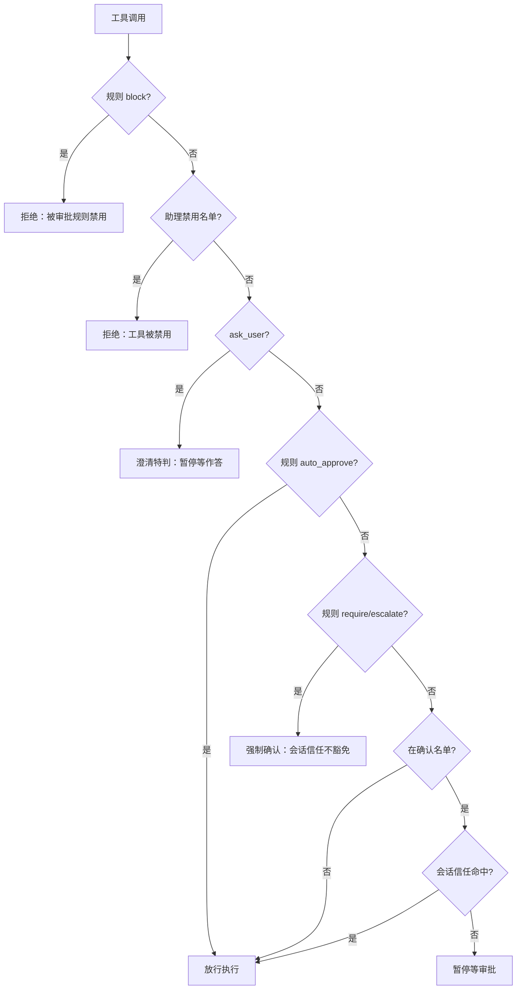

# 工具执行权限与审批规则

整个权限域分两层：**谁能操作工作台**（用户角色）与**智能体能执行什么工具**（风险标签 + 审批闸门）。本文覆盖后者为主，前者只列口径。审批的「暂停—决策—恢复」机制见《审批与澄清交互》，本文讲**谁被拦、为什么被拦、按什么顺序判定**。

## 用户角色（API 层）

`users.role` 三档：**admin** 全权 / **developer** 写操作 / **viewer** 只读。接口依赖 `require_auth`（登录即可，只读）/ `require_not_viewer`（写操作）/ `require_admin`（用户管理、LLM 配置、审批规则增删改、升级单批准）。

## 工具的两种约束

| 约束 | 含义 | 命中效果 |
|---|---|---|
| **禁用名单** | 助理配置里屏蔽的工具（disallowed_tools） | 直接拒绝执行，不进审批（硬约束） |
| **确认名单** | 需人工批准才能执行的工具（confirm_tool_names） | 暂停等审批，可批准/拒绝 |

确认名单在**装配时**生成（`build_agent_tool_bundle`），由三层输入合成，从底到顶：

**风险标签三档**（`skill_bundle.RISK_LEVELS`，审批规则 `RULE_RISKS = RISK_LEVELS`）：`safe`（只读）/ `mutating`（有副作用）/ `dangerous`（高危）。这是**平台侧属性，ADK 规范外新增**；技能、审批规则、MCP 工具共用这套口径。注意 MCP 的 `tool_risk_map` 只按只读启发式打 `safe | mutating` 两档（不自动打 dangerous），dangerous 主要由技能/人工配置声明。

审批判定有两根**独立轴**，排错时务必分开：
- **风险标签**（safe/mutating/dangerous）：用于审批规则的 `risk` 过滤与展示；
- **是否审批**：由 server 策略 + 确认名单 + 审批规则决定。

1. **MCP server 三档策略**（`mcp_servers.approval_policy`）：`never` 不审 / `non_readonly` 非只读工具审 / `always` 全审。只读判定是启发式（工具名 get_/list_/search_/query_/read_/find_/describe_ 前缀，或描述含 read-only）。**风险只做展示与规则过滤，是否审批由 `approval_policy` 这根轴决定**（`confirm_tool_names_for_servers`）。
2. **内置工具风险**（`tools/catalog.py` 的 `risk` 字段）：14 个内置工具中 `run_workflow` 是 `mutating`，其余为 `safe`。非 safe 的内置工具默认进确认名单（此前只做工作流画布禁入，对话中不进审批——已补齐）。只读模式（助理 permission_mode=read-only）会把该助理全部 MCP 工具并入确认名单。
3. **审批规则**（`approval_rules` 表）：精确覆盖下面两层，见下节。

## 审批规则引擎

规则按 **工具名通配 × 助理 × 风险** 匹配，动作四档，**命中即覆盖 server 策略**：

| 动作 | 效果 |
|---|---|
| `auto_approve` | 强出确认名单，免审直跑 |
| `require_approval` | 强进确认名单，**会话信任不豁免** |
| `block` | 闸门直接拒绝（「被审批规则禁用」），不进审批流程 |
| `escalate` | 强进确认名单，审批单标**升级**：仅 admin 可批准/续跑（拒绝不受限，拒绝是安全动作） |

匹配与优先级（首条命中生效，顺序确定可测）：

1. 只看启用（enabled）的规则；
2. 工具名按 `fnmatch` 通配匹配 `tool_pattern`（如 `mcp__obs-tools__*`、`run_workflow`、`*`）；
3. `agent_id` 空 = 全部助理，非空 = 仅该助理；`risk` 空 = 不限，非空 = 仅该风险标签的工具；
4. 排序：**工具名越具体越优先**（无通配 > 前缀通配 > 其他通配，纯 `*` 是兜底）→ 助理专属 > 全局 → `priority` 大者先 → 创建早者先。

「风险」过滤的语义：`risk` 取 `safe | mutating | dangerous`（校验见 `validate_rule_fields`），空 = 不限。MCP 工具的风险来自 `tool_risk_map`（只读启发式，两档）；审批规则的 risk 过滤与这根标签轴联动，但与「是否审批」的策略轴独立。排错时先确认工具的风险标签，再看策略与规则动作。

规则是**例外**机制，server 策略是**基线**：没有规则命中时一切按现状（策略 + 信任）。典型用法：给单个高危工具升级（escalate）、只读工具批量免审（`risk=safe` + auto_approve）、审计期整体加锁（`*` + `risk=safe` + require_approval）。

## 闸门判定顺序

`before_tool_callback`（`adk_runtime/tool_approval.py`）对每次工具调用依次判定：

要点：

- **规则优先于会话信任**：用户对规则命中工具选「不再询问」不生效（admin 策略优先）；未命中规则的工具维持现状语义。
- **规则优先于 server 策略**：auto_approve 能放掉策略要求审批的工具，require_approval 能锁住策略免审的工具。
- ask_user 特判在规则动作之后但语义独立——澄清不是审批，会话信任与规则都不豁免提问。

## 会话级信任（免审）

审批卡「批准并执行」的下拉两项（信任此工具 / 信任所有工具）把免审范围写进 ADK 会话状态 `skip_tool_approvals`，随会话持久化，只作用于**未命中规则**的确认名单工具；ask_user 照常询问。详见《审批与澄清交互》。

## 审批单据与升级

`approvals` 表六态：`pending → approved → executed | failed`、`rejected`、`expired`。生命周期细节见《审批与澄清交互》，权限相关的三个点：

- **升级标记**：命中 escalate 规则的工具建单时在 `payload.escalated` 打标（存 payload JSON，不动表结构）；批准/续跑/批量批准逐单校验，非 admin 返回 403。审批卡与收件箱显示「升级」徽标。
- **SLA 临期提醒**：pending 单在超时时长的 80%（`knowledge.approval_timeout_hours`）后出 `sla_warning`，收件箱显示「即将超时」徽标——**只提醒不处置**，到点仍走 expired（绝不自动批准）。
- **决策权限**：`require_not_viewer`；升级单额外要求 admin。拒绝任何单据不需要升级权限。

### 决策链路的四个关键实现（approval_service.py）

1. **原子认领 `_claim_pending_approval`**：用条件 UPDATE（带 `WHERE status=pending` 等条件）+ `rowcount > 0` 判定认领成功，避免两个管理员同时批准同一单据导致重复执行。`stream_decide` 在真正续跑前先认领。
2. **turn_context 禁止回落默认模型**：建单时把发起回合的上下文（provider / model / model_prefix / provider_extra_body / llm_timeout_seconds / thinking_enabled / web_search_enabled 等）写进 `payload.turn_context`。`_turn_context_from_approval` 读出后逐字段校验，**缺失即失败，禁止回落会话默认模型**——否则续跑行为与发起时不一致（会话默认模型可能被单回合覆盖）。
3. **stream_decide 用发起时同套装配**：续跑时重新 `build_agent_tool_bundle`（确认/禁用/规则动作与发起时同源），再用 turn_context 建模型，保证「批准后执行的工具权限与模型」与暂停前一致。
4. **工具异常兜底 + 沙盒执行**：续跑同样复用 `on_tool_error_callback=tool_error_as_result`（工具异常转错误结果，不打断回合）；`run_python` 类工具走统一沙盒执行入口（docker/local 可切、断网默认、绝不回退宿主机），详见《沙盒与可观测架构》。

## 配置与审计入口

| 能力 | 入口 | 权限 |
|---|---|---|
| MCP server 审批策略 | MCP 页（never / non_readonly / always） | admin |
| 审批规则 CRUD | `/approval-rules` 页、`/api/v1/approval-rules` | 列表登录可读；增删改 admin |
| 审批超时时长 | 设置 → 知识库（`knowledge.approval_timeout_hours`） | admin |
| 会话免审 | 审批卡下拉（tool / all） | 决策者本人，随会话生效 |

审计动作：`approval.approve / approval.reject / approval.batch_approve / approval.batch_reject`（升级限制拒绝对应 403 无审计动作）、`approval_rule.create / approval_rule.update / approval_rule.delete`、`mcp.save` 等；规则与策略变更均留痕。

## 涉及文件

- 风险三档定义：`services/skills/skill_bundle.py`（`RISK_LEVELS`）、`services/chat/approval_rule_service.py`（`RULE_RISKS`）、`api/approval_rules.py`（risk Literal）。
- 判定与闸门：`services/mcp/mcp_service.py`（`_needs_approval` / `tool_risk_map` / `confirm_tool_names_for_servers`）、`tools/catalog.py`（内置 risk）、`adk_runtime/tool_approval.py`（判定顺序、会话信任）。
- 规则引擎：`services/chat/approval_rule_service.py`（匹配与优先级、名单改写、单工具重查）、`models/approval_rule.py`、`api/approval_rules.py`。
- 名单装配：`services/agent/agent_tool_service.py`（`build_agent_tool_bundle` 合成确认/禁用/规则动作）→ `adk_runtime/agent_factory.py` 挂闸（含 `on_tool_error_callback=tool_error_as_result`）。
- 单据与决策：`services/chat/approval_service.py`（原子认领、turn_context 禁止回落、同套装配、建单打升级标记、SLA 临期）、`api/approvals.py`（升级权限校验）。
- 执行边界：`services/sandbox/sandbox_service.py`（统一沙盒入口）、`adk_runtime/sandbox_code_executor.py`（技能脚本）。
- 前端：`pages/ApprovalRules.tsx`（规则表与编辑器）、`pages/Approvals.tsx`（升级/即将超时徽标）、`components/MessageBubble.tsx`（审批卡免审下拉）。
- 测试：`tests/test_approval_rules.py`（匹配优先级、闸门压过信任、升级权限、SLA）、`tests/test_mcp_approval_policy.py`（展示与闸门同源）、`tests/test_session_trust.py`。

## 维护地图（改代码时同步更新）

| 变更 | 改哪里 |
|---|---|
| 风险档位 | `skill_bundle.RISK_LEVELS`（联动 `approval_rule_service.RULE_RISKS`、API Literal） |
| 闸门顺序/会话信任 | `adk_runtime/tool_approval.py` |
| 规则匹配/动作 | `services/chat/approval_rule_service.py` |
| 名单装配/错误兜底 | `agent_tool_service.py` + `agent_factory.py` |
| 决策链路 | `services/chat/approval_service.py` |
