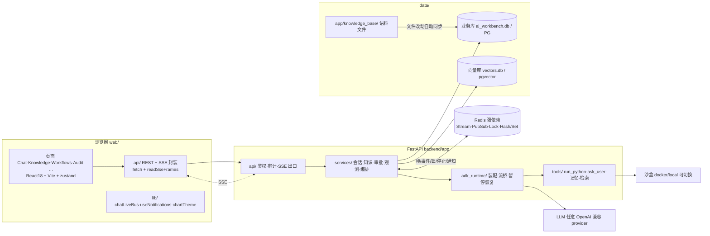
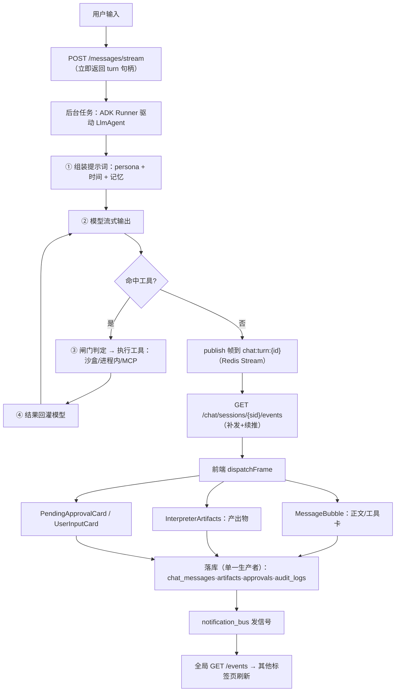

# 整体架构

Ongrid AI 工作台：对话式智能体的单机全栈应用。核心原则是**用 ADK 装配智能体，禁止自研 agent loop**；图表、产出物、审批、澄清等重交互一律走结构化通道（工具 + 帧 + 落库），不走提示词技巧。**Redis 是强依赖**：所有跨进程协同（帧分发、事件、锁、停止、通知）都收口到 Redis，权威业务数据仍在数据库。

> 本文是全景入口。各子系统的深入设计见文末「专题文档索引」。

## 组件全景

## 分层职责

| 层 | 位置 | 职责 | 典型模块 |
|---|---|---|---|
| HTTP | app/api | 路由、鉴权（admin/developer/viewer）、写操作审计、SSE 出口 | chat.py、events.py、knowledge.py、approvals.py |
| 业务 | app/services | 会话编排、知识切块嵌入、审批流、观测、任务图、触发调度 | chat_service、knowledge_service、approval_service、task_graph_service |
| 智能体 | app/adk_runtime | LlmAgent 装配、工具/技能装配、事件桥、暂停恢复、无人值守闸门 | agent_factory、stream_bridge、tool_approval、workflow_graph |
| 工具 | app/tools | 内置工具实现与目录 | code_interpreter、chart_spec、user_input、catalog |
| 协同 | app/redis + services/platform/redis_distributed | Redis 连接单例、帧总线、事件总线、锁/租约/停止/共享标志、通知 | chat_stream_bus、notification_bus、RedisLock、LeaderLease |
| 持久 | app/models、app/vector_store | 表模型；向量存储可切换（sqlite/pgvector/none） | KnowledgeDoc、Artifact、vector_items |

## 一次对话的端到端流程

Redis 改造后，**帧生产与 HTTP 连接解耦**：后台任务消费 runner、落库、推流，所有标签页从 Stream 读。

## 数据面

- **业务库** `data/ai_workbench.db`（或 PG）：配置类表（app_settings、llm_providers、mcp_servers、user_agents、workflows、trigger_rules、users/api_tokens）与数据类表（chat_*、artifacts、approvals、audit_logs、memory/knowledge/eval_*、运行记录、观测）。
- **向量库** `data/vectors.db`（或 pgvector）：单表 `vector_items`，namespace 分语料（knowledge_chunks / memory_items / mcp_tools），与业务库分离、可单独备份迁移；`VECTOR_BACKEND=none` 时向量依赖功能显式失败。
- **Redis**：只承载协同态与传输通道——对话帧 Stream、事件 Stream、通知 Stream、分布式锁、停止信号、共享标志/集合。不存权威业务数据；大 payload（图表）仍走 artifacts 表，Stream 只传事件与引用。
- **内置知识库语料** `app/knowledge_base/`：文件即事实源，改动自动同步进 vault 作用域（见《知识库与检索架构》）；本目录即本文档所在处。

## 与周边系统的关系

- **工作流**：定义（workflows）与运行（workflow_runs/node_runs）分离；节点可试跑、运行可停止、节点可挂审批；画布工具节点与内置工具目录同源。
- **任务图**：编译成工作流 DAG，由同一引擎驱动，外面套规划/节点执行/汇总的系统运行壳与独立事件通道。
- **触发器**：trigger_rules 由调度循环按 cron 计算下次触发，产生 trigger_runs；调度循环用 LeaderLease 保证多 worker 单实例。
- **评测**：eval_datasets/cases/runs + 门禁（gate）支撑回归与红队；评测跑真实会话并落观测 trace。
- **治理**：写操作全覆盖审计（消息发送除外，已有消息全量落库作为事实源）；审批既管高危工具确认，也承载 ask_user 澄清答案。
- **发布**：渠道 = Key + 助理 + 持久会话，暴露 OpenAI 兼容端点，走 Redis 锁串行化（见《发布渠道架构》）。

## 专题文档索引

**智能体与能力**
- 《对话与智能体架构》：消息链路、提示词三块、流式管线、持久化回放
- 《Agent装配与子代理架构》：三工厂、能力面八步、子代理、错误兜底、无人值守
- 《Skill架构》：磁盘+DB 技能统一装配、EAGER 发现、脚本沙盒
- 《工具执行权限与审批规则》：风险三档、审批闸门、规则引擎、会话信任
- 《审批与澄清交互》：暂停—决策—恢复生命周期
- 《产出物与图表架构》：图表产出物与正文锚点
- 《ADK会话与状态管理架构》：双轨会话、单例 SessionService、回放微秒技巧、stale session 防护

**外部能力与配置**
- 《MCP全链路架构》：wire 命名、连接方式、鉴权装配、发现探活、两条装配路径、审批双轴
- 《LLM供应商与模型配置架构》：provider 模型、LiteLlm 装配、手动价、probe/seed/reveal
- 《评测系统架构》：数据模型、双通道判分、对抗用例、门禁/CI、红队标注
- 《发布渠道架构》：Key 签发、会话复用与 Redis 锁、OpenAI 兼容端点
- 《系统设置与系统时区架构》：通用键值、固定偏移时区、reveal 脱敏

**编排与协同**
- 《工作流与任务图架构》：DAG 引擎、15 节点类型、任务图编译执行汇总
- 《Redis强依赖与多worker协同架构》：帧总线、事件总线、锁/租约/停止、通知、多 worker
- 《前端架构》：技术栈、路由守卫、SSE 全链路、实时通知、刷新策略

**知识与数据**
- 《知识库与检索架构》：双作用域、切块嵌入、混合检索 RRF、外部源状态机
- 《记忆与工具索引架构》：记忆 hint/recall、MCP 工具索引缓存、嵌入客户端
- 《数据模型全景》（reference）：43 张业务表按域速查、token_hash 复用、ADK/向量边界
- 《数据模型与权限说明》（reference）：角色、鉴权机制、审计、表两大类
- 《API接口参考》（reference）、《内置工具与技能说明》（reference）

**横切基础设施**
- 《沙盒与可观测架构》：隔离执行、Trace/工具调用、审计、脱敏、用量
- 《凭证与只读分享架构》：凭证加密轮换、会话/评测只读分享

**运维与诊断**
- 《部署与运维指南》（systems）：服务构成、启停、环境变量、健康检查、多 worker
- 《常见故障排查》与各 diagnostics/ 手册

## 文档维护约定

**改代码即改知识库**：任何影响本库文档内容（接口、工具契约、数据模型、部署方式、排障路径、架构决策）的代码变更，必须在同一轮更新 `app/knowledge_base/` 对应文档，保持准确、完整。图表结构与主题、接口表、工具契约尤其如此。
