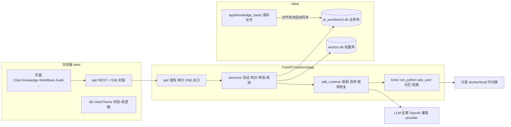
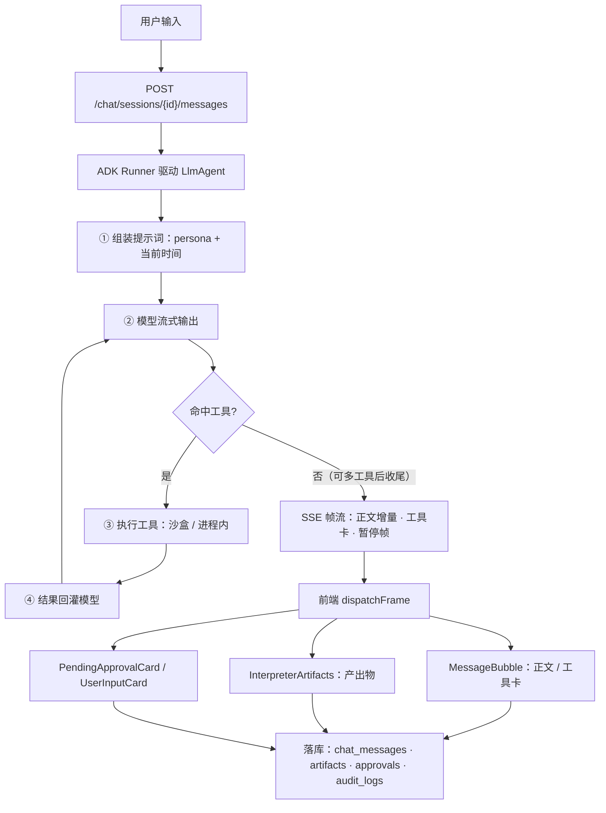

# 整体架构

Ongrid AI 工作台：对话式智能体的单机全栈应用。核心原则是**用 ADK 装配智能体，禁止自研 agent loop**；图表、产出物、审批、澄清等重交互一律走结构化通道（工具 + 帧 + 落库），不走提示词技巧。

## 组件全景

## 分层职责

| 层 | 位置 | 职责 | 典型模块 |
|---|---|---|---|
| HTTP | app/api | 路由、鉴权（admin/developer/viewer）、写操作审计、SSE 出口 | chat.py、knowledge.py、approvals.py |
| 业务 | app/services | 会话编排、知识切块嵌入、审批流、观测、触发调度 | chat_service、knowledge_service、approval_service |
| 智能体 | app/adk_runtime | LlmAgent 装配、工具/技能装配、事件桥、暂停恢复 | agent_factory、stream_bridge、tool_approval |
| 工具 | app/tools | 内置工具实现与目录 | code_interpreter、chart_spec、user_input、catalog |
| 持久 | app/models、app/vector_store | 表模型；向量存储可切换（sqlite/pgvector/none） | KnowledgeDoc、Artifact、vector_items |

## 一次对话的端到端流程

## 数据面

- **业务库** `data/ai_workbench.db`：配置类表（app_settings、llm_providers、mcp_servers、user_agents、workflows、trigger_rules、users/api_tokens）与数据类表（chat_*、artifacts、approvals、audit_logs、memory/knowledge/eval_*、运行记录、观测）。
- **向量库** `data/vectors.db`：单表 `vector_items`，namespace 分语料（knowledge_chunks / memory_items / mcp_tools），与业务库分离、可单独备份迁移。
- **内置知识库语料** `app/knowledge_base/`：文件即事实源，改动自动同步进 vault 作用域（见《检索与知识架构》）。

## 与周边系统的关系

- **工作流**：定义（workflows）与运行（workflow_runs/node_runs）分离；节点可试跑、运行可停止、节点可挂审批；画布工具节点与内置工具目录同源。
- **触发器**：trigger_rules 由调度循环按 cron 计算下次触发，产生 trigger_runs。
- **评测**：eval_datasets/cases/runs + 门禁（gate）支撑回归与红队。
- **治理**：写操作全覆盖审计（消息发送除外）；审批既管高危工具确认，也承载 ask_user 澄清答案。

## 文档维护约定

**改代码即改知识库**：任何影响本库文档内容（接口、工具契约、数据模型、部署方式、排障路径、架构决策）的代码变更，必须在同一轮更新 `app/knowledge_base/` 对应文档，保持准确、完整。图表结构与主题、接口表、工具契约尤其如此。
