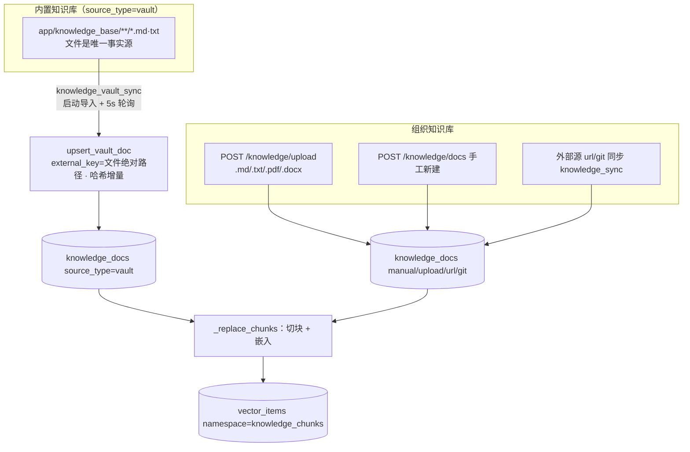
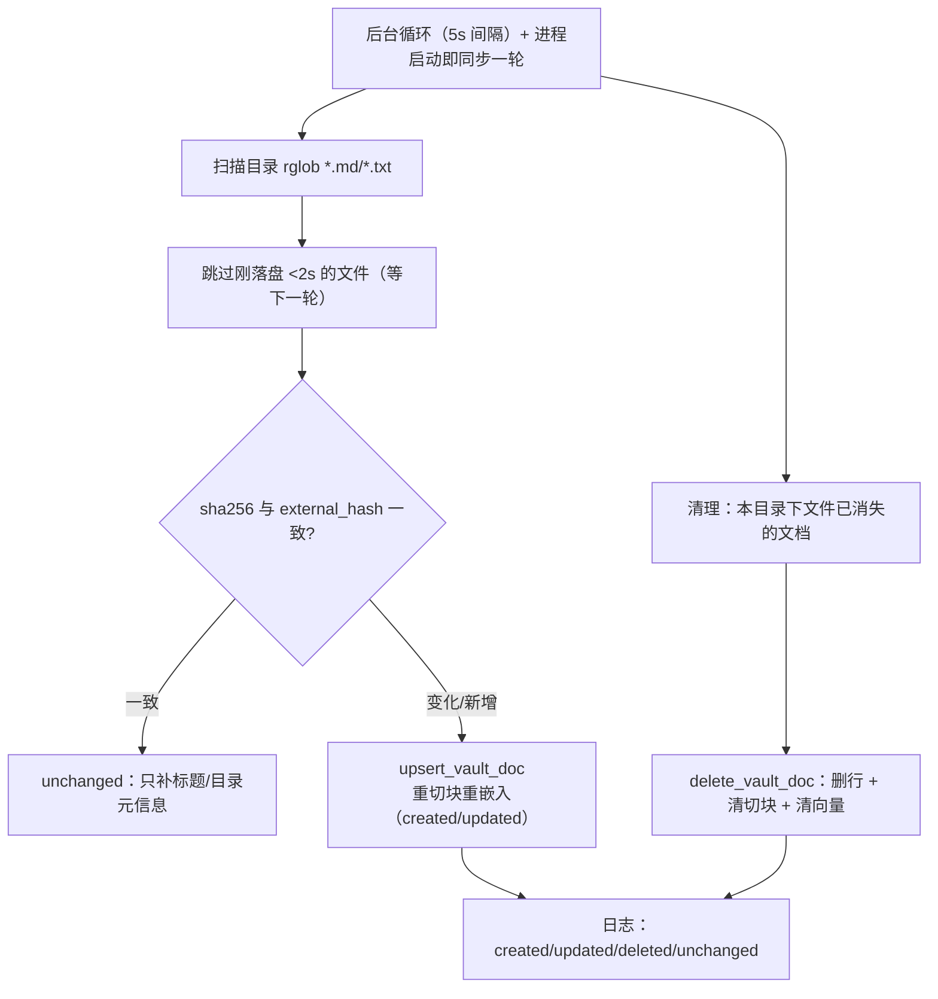
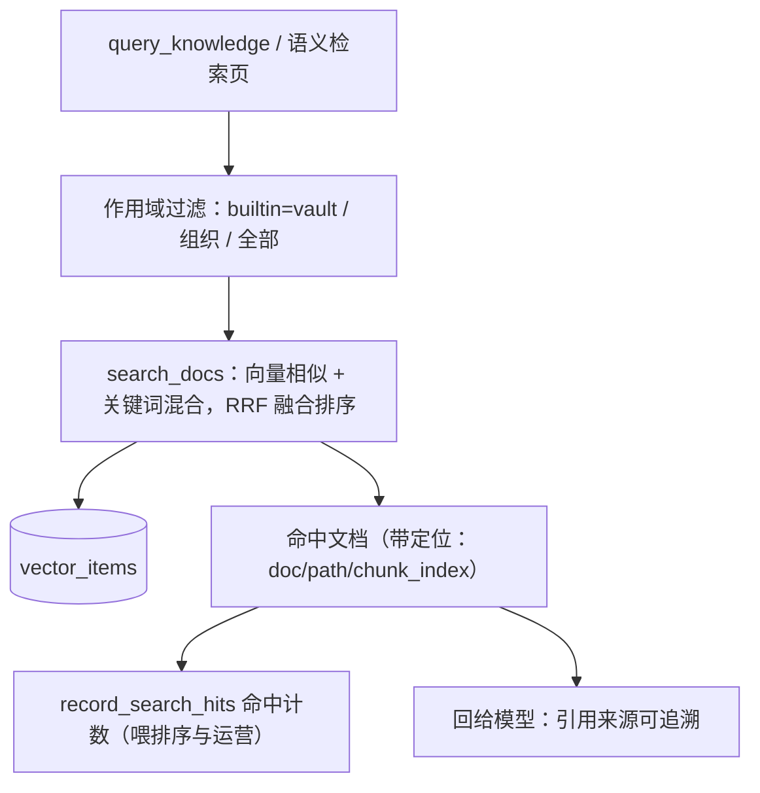

# 检索与知识架构

知识库分两个作用域：**内置（vault）**——文件即事实源、自动同步、应用内只读；**组织**——上传/手工/外部源入库、应用内可编辑。检索、记忆、MCP 工具索引共用同一套「切块 → 嵌入 → 向量库」管线。

## 双作用域与入库通道

## 内置知识库文件同步（services/knowledge/knowledge_vault_sync.py）

要点：

- 文档身份 = 语料文件绝对路径（external_key），据此圈定归属：只同步、只清理本目录下的文档，多目录/测试互不干扰。
- 标题取正文首个一级标题（无则文件名）；目录归属取文件相对路径的父目录（前端按段本地化，如 diagnostics/dns → 诊断 playbook/DNS）。
- 应用内 vault 文档只读（编辑/移动/删除均拒绝）：改动请改文件，秒级自动生效。
- 检索开关（enabled）保留用户设置：同步只动内容，不重置启停。

## 检索链路

- 切块参数（大小/重叠）存系统设置（`knowledge.chunk_size=800` / `knowledge.chunk_overlap=100`），reindex 可按当前配置全量重建；切块默认窗口 800 / overlap 100。
- 向量库可切换实现（sqlite / pgvector / none）；none 时向量操作显式失败，不假装可用。

### 混合检索的精确口径（search_docs）

`search_docs()` 是向量 + 关键词的双通道检索，RRF 融合：

1. **向量道**：`embed_text(query)` → `vs.search(KNOWLEDGE_NAMESPACE, vec, pool=limit*4)` → 用 `ref_id`（chunk id 字符串）回业务库 join `KnowledgeChunk+KnowledgeDoc`，过滤 enabled + 作用域（builtin/source_type + path/path_prefix/tags/scope）→ 相似度 `< 0.5` 丢弃（注释给出依据：模型噪声 ≤0.47 / 真命中 ≥0.59）。
2. **关键词道**：`KnowledgeChunk.content ILIKE %query%`（LIKE 通配符转义），固定按 chunk id 排序保证可复现，limit=pool。
3. **RRF 融合**（`_RRF_K=60`）：按文档聚合，每个通道每文档只取最优排名，`score += 1/(60+rank)`；阈值 `knowledge.rrf_min_score`（可被 `min_score` 覆盖）→ 排序取 top limit，返回 `KnowledgeHit`（doc/score/chunk_index/content/vector_score/keyword_rank）。

- **路径匹配**：`path_condition()` 为本级或子级，`startswith(path + "/", autoescape=True)`——避免 `网络` 命中 `网络安全`。
- `record_search_hits()` 记 `hit_count+1` / `last_hit_at`，显式带 `updated_at=KnowledgeDoc.updated_at` 阻止 onupdate 误写；一次检索同文档只计 1 次。

### 助理知识范围在 SQL 层收口（knowledge_scope.py）

`KnowledgeScope(paths, doc_ids)`：`empty_scope()` 表示继承全部（`scope_condition()` 返回 None，不加条件）。目录间/文档间 OR，范围整体与请求的 path/tags 过滤 AND。上限 `MAX_SCOPE_PATHS=20` / `MAX_SCOPE_DOC_IDS=100`，`parse_scope()` 校验字段名与类型、去重保序。保存前 `validate_scope()` / `scope_preview()` 把命中 0 篇的目录/文档一次报全，不静默降级。

### 外部源同步状态机（knowledge_sync.py）

- 状态 `idle → syncing → ok/error`；同步中禁止改配置/删除；`recover_interrupted_syncs()` 启动时把遗留 syncing 标 error。
- URL 源走 httpx 条件请求（If-None-Match / If-Modified-Since，304 → not_modified），上限 2MB，HTML 去脚本/导航取正文；Git 源走 `git clone --depth 1 --single-branch`（禁交互提密、超时 180s），`path_prefix` 越界校验，最多 200 篇、单文件≤2MB。
- 每篇按内容哈希增量 upsert，结束清消失文档，写审计 + 经 `notification_bus` 发 `knowledge_sync_done`（见《Redis强依赖与多worker协同架构》）。

## 记忆与工具索引

| namespace | 来源 | 说明 |
|---|---|---|
| knowledge_chunks | 知识文档切块 | 上文两作用域共用；ref_id = chunk id 字符串 |
| memory_items | remember_memory / recall_memory | 跨会话记忆，助理级 + 全局；ref_id = MemoryItem id |
| mcp_tools | MCP 工具语义索引 | 配置衍生物，随 MCP 配置重建；ref_id = 工具 wire 名 |

向量库按 `(namespace, ref_id)` 寻址，`search` 返回按余弦相似度降序的 `(ref_id, similarity)`；调用方自行回业务库 join 并做属性过滤。`VectorStoreUnavailable` 统一映射 503（环境/契约错误），请求参数错误 400。

### 记忆：hint + recall 双路径（memory_service.py）

- **存储**：`MemoryItem(content, scope_agent_id=NULL 全局, source_session_id, enabled, created_by)`，内容上限 2000 字符。`remember()` 算向量 → flush 业务行 → upsert `MEMORY_NAMESPACE` → commit；失败回滚业务行并尽力删向量。
- **语义回忆 `recall()`**：`vs.search(MEMORY_NAMESPACE, embed_text(query), limit*4)` → 回业务库 `id in ref_ids AND enabled=True` → 作用域过滤（本助理 ∪ 全局）→ 截 limit（默认 5）。
- **自动注入 `compose_memory_hint()`**：取 enabled 的本助理 ∪ 全局记忆按 created_at desc 最多 20 条拼成「长期记忆」段落注入人设——**不依赖模型自觉调用工具**（见《Agent装配与子代理架构》提示词来源）。
- **生命周期**：`forget()` 先删业务行再删向量（残留向量只是孤儿）；`set_enabled()` 停用不删向量（可重新启用）。

### MCP 工具语义索引（tool_search_index.py）

替代 adk_tool_search 默认 BM25（英文分词对中文无效）：`McpToolEmbedding` 表只存元数据（tool_name/search_text/content_hash），向量在 `MCP_TOOL_NAMESPACE`。

- `build_tool_search_text()` 与 adk_tool_search 的 `ToolEntry.search_text` 对齐（name + description + 参数名/描述），保证入库与运行时一致。
- `sync_server_tool_embeddings()`：探测成功后全量替换该 server 向量；按 content_hash 复用旧向量、清消失工具、向量 upsert 先行再提交元数据。
- **两套缓存必须分开**：`_VECTOR_CACHE`（键 = wire 名，上限 4096，按插入顺序淘汰）与 `_QUERY_VECTOR_CACHE`（键 = 文本哈希，上限 512）。`warm_vector_cache_from_db()` 装配前幂等预热；`assert_embedding_names_consistent()` 校验向量命名与 `mcp__{server}__{tool}` wire 规则一致。
- `EmbeddingToolIndex.rebuild/search` 只读缓存（缺向量抛错），`search` 用预取查询向量，余弦排序 + 名称精确命中 +1；`PrefetchingEmbeddingToolset.search_tools()` 先异步预取查询向量再进同步检索，避免阻塞事件循环。

### 嵌入客户端（embedding_client.py）

OpenAI 兼容 `/v1/embeddings`，必须显式传 `encoding_format="float"`（部分兼容端点数组输入缺省返回 base64 或报 SiliconFlow 20015）；校验条数/数组/维度 == `EMBEDDING_DIM`（不符抛错，不静默）。网络失败/非 200 → `EmbeddingServiceUnavailable`（503）。

## 维护地图（改代码时同步更新）

| 变更 | 改哪里 |
|---|---|
| 同步行为/间隔 | services/knowledge/knowledge_vault_sync.py + tests/test_knowledge_vault_sync.py |
| 切块/嵌入管线 | services/knowledge/knowledge_service._replace_chunks + config.py（EMBEDDING_*） |
| 作用域/检索口径 | services/knowledge/knowledge_scope.py + knowledge_service.search_docs / _source_condition + tests/test_knowledge_scope.py |
| 混合检索参数 | knowledge_service（_VECTOR_MIN_SIMILARITY / _RRF_K）、系统设置 knowledge.rrf_min_score |
| 外部源同步 | services/knowledge/knowledge_source_service.py（校验/状态机）+ knowledge_sync.py（执行） |
| 记忆 | services/knowledge/memory_service.py（recall / compose_memory_hint） |
| MCP 工具索引 | services/mcp/tool_search_index.py（两套缓存 + wire 命名一致） |
| 向量后端 | app/vector_store/{__init__,sqlite_backend,pgvector_backend}.py |
| 语料内容 | 直接改 app/knowledge_base/ 文件，秒级生效 |
