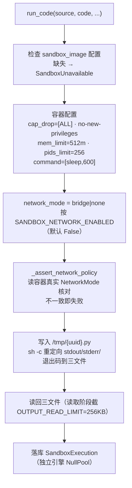

# 沙盒与可观测架构

本文覆盖两条横切基础设施：**沙盒**（用户代码/技能脚本的隔离执行）与**可观测**（回合 Trace、工具调用、审计、脱敏、用量）。

## 沙盒执行（services/sandbox/sandbox_service.py）

### 统一入口与执行器切换

`run_code()` 是唯一执行入口。代码来源有 skill / workflow / manual / chat 四类，仅 `SandboxContext`（source / source_ref / session_id / workflow_run_id）不同，执行路径完全一致。返回 `SandboxResult`（execution_id / stdout / stderr / exit_code / status / error / duration_ms）。

`SANDBOX_EXECUTOR` 切换执行器：

| 值 | 行为 |
|---|---|
| `docker`（默认） | llm-sandbox + Docker 容器隔离 |
| `local` | 当前解释器直接跑，无隔离，仅供可信开发 |

**绝不自动回退**：Docker 不可用时一律归 `SandboxUnavailable`（用户侧报「环境不可用」而非「代码写错」）；依赖缺失也归此类——「依赖没装是环境问题，不是用户代码问题」。

### 容器加固与网络策略

- **加固**：`cap_drop=["ALL"]`、`security_opt=["no-new-privileges"]`、`mem_limit=512m`、`pids_limit=256`，`command=["sleep", 600]` 顶住主进程。
- **网络隔离**：`network_mode = bridge | none` 由 `SANDBOX_NETWORK_ENABLED`（默认 False）控制；执行前 `_assert_network_policy` 读容器**真实** `NetworkMode` 核对——配置要断网但容器设成 bridge、或要联网却是 none，都失败。断网时带 libraries 会直接拒绝（pip 无法联网）。
- **超时**：容器内 `execution_timeout=timeout`，外层 `asyncio.wait_for(timeout + 30s)` 兜 Docker 守护进程卡住；默认 120s，上限 600s。状态 `succeeded / failed / timeout`。
- **输出收集**：代码经 `put_archive` 写入容器，用 `sh -c` 把 stdout/stderr/退出码重定向到三个文件再读回——绕开 `docker exec` EOF 丢帧导致「成功但 stdout 为空」的实测问题。读取阶段截 `OUTPUT_READ_LIMIT=256KB`，落库再截 20000 字符。
- **落库 `_record()`**：用独立引擎（`NullPool`）与独立会话，不绑业务事务、不复用跨事件循环连接池；**成功失败都写一条** `SandboxExecution`（source / image / network_enabled / 代码 / 输出 / 退出码 / 耗时 / 起止时间）。

### 与技能沙盒执行器的关系

`adk_runtime/sandbox_code_executor.py` 的 `SandboxCodeExecutor`（ADK `BaseCodeExecutor`，`stateful=False`）用于技能脚本，替换默认 `UnsafeLocalCodeExecutor`。`execute_code()` 是同步契约，用 `asyncio.run(_main())` 在 ADK 线程池（无运行事件循环）里调 `sandbox_service.run_code()`，上下文 `source=skill`。沙盒不可用时不回退宿主机，返回 `exit_code=1` + 明确错误（见《Skill架构》）。

## 可观测（services/observability/）

### 回合 Trace 与工具调用

`observation_service.py` 在 `chat_service.stream_session_message` 的关键点写入：回合起始（L1758）、工具 call（L1366/1403）、first_token（L1853）、收尾（L1871-1875）。

**`observation_turns` 字段**：id(trace_id)、session_id、agent_id、provider、model、status(running/ok/error/stopped)、request_id、channel（空=站内，非空=发布渠道名）、input_summary(截断 500)、error_message、prompt/completion/total_tokens、duration_ms、first_token_ms(TTFT)、tool_call_count、skill_call_count、started_at、ended_at。

**`observation_tool_calls` 字段**：id、trace_id、tool_call_id、name、kind(skill|mcp|tool)、detail、status(running|ok|error)、duration_ms、error、started_at。`classify_tool()`：`load_skill`/`list_skills` → skill（从实参取 skill_name 填 detail），`mcp__` 前缀 → mcp（取 server 段），其余 tool。

- 所有观测写入走**独立 `SessionLocal` 会话**，避免与流式回合共用 db 互相 commit。
- `record_tool_end()` 结束调用并累加所属 turn 的 skill/tool 计数（审批续跑缺 start 时补登记）。
- `_finish_turn()` 写 token：无有效值保持 NULL，**禁止假 0**。
- 汇总 `summarize_turns()`：PG 用 `percentile_cont(0.95)` 算 P95，SQLite 按最近秩 offset 估算；按时间/状态/助理/模型/渠道/最短耗时过滤，q 同时匹配 trace/session/request id。

### 审计、脱敏、用量

- **审计** `audit_service.write_audit()`：独立会话即写即提交；字段 actor_user_id / action / resource_type / resource_id / detail_json / request_id。
- **脱敏** `redaction.py`：`redact_value()` 递归——dict 按键名、str 按内嵌密钥、http(s) URL 结构化遮蔽 userinfo 密码与敏感查询参数；复用 `app.logging_setup.is_secret_key/redact_secrets`，`MASK='***'`。供审计导出、配置快照、凭证清单共用。
- **用量** `usage_service.py`：
  - 数据源**仅** `observation_turns`（`chat_messages.stats_json` 不进聚合）。
  - 按 **日 × 模型 × 助理 × 渠道** 一次 SQL 分组，Python 侧滚动出 by_day / by_model / by_agent / 总计三视角。
  - 日界按系统时区固定偏移（`get_system_timezone`，见《凭证/分享/发布与系统设置架构》）。
  - 成本只认 `llm_providers.model_prices_json` 手动价（input/output_per_1m）：缺价 → `None`（显示「未计价」，**绝不按 0 计**）；分组内出现任一未计价回合则整个成本合计输出 None（宁可「—」也不给半真数字）。
  - `duration_avg_ms` 用 sum/count 再平均。
  - 软限额 `usage.daily_token_soft_limit` 只提醒不拦截；`today_tokens` 口径不跟随筛选条件（看全站今天）。

## 维护地图（改代码时同步更新）

| 变更 | 改哪里 |
|---|---|
| 沙盒执行/加固/网络 | `services/sandbox/sandbox_service.py`、`adk_runtime/sandbox_code_executor.py` |
| Trace/工具调用字段 | `services/observability/observation_service.py`、`models/observation.py` |
| 用量口径/成本 | `services/observability/usage_service.py` |
| 审计/脱敏 | `services/observability/audit_service.py`、`redaction.py` |
| 沙盒配置 | `config.py`（SANDBOX_*） |
