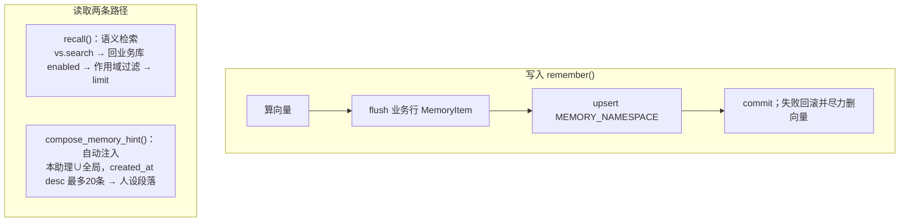
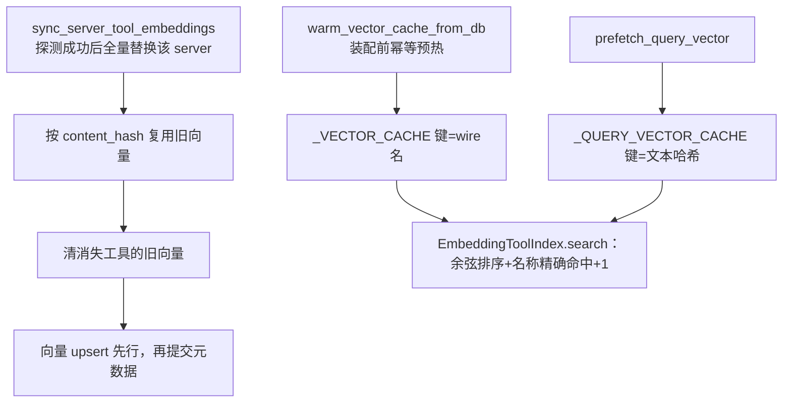

# 记忆与工具索引架构

记忆与 MCP 工具索引是向量库的两个独立业务域，与知识库共用同一套「切块 → 嵌入 → 向量库」底座（见《知识库与检索架构》）。本文聚焦这两个域各自的存储、检索与生命周期，以及共用的嵌入客户端。

## 向量库命名空间总览

| namespace | 来源 | ref_id | 说明 |
|---|---|---|---|
| knowledge_chunks | 知识文档切块 | chunk id 字符串 | 知识库与检索（见《知识库与检索架构》） |
| memory_items | remember_memory / recall_memory | MemoryItem id | 跨会话记忆，助理级 + 全局 |
| mcp_tools | MCP 工具语义索引 | 工具 wire 名 `mcp__{server}__{tool}` | 配置衍生物，随 MCP 配置重建 |

向量库按 `(namespace, ref_id)` 寻址，`search` 返回按余弦相似度降序的 `(ref_id, similarity)`；调用方自行回业务库 join 并做属性过滤。`VectorStoreUnavailable` 统一映射 503（环境/契约错误），请求参数错误 400；`VECTOR_BACKEND=none` 时向量依赖功能显式失败，不假装可用。

## 记忆：hint + recall 双路径（memory_service.py）

- **存储**：`MemoryItem(content, scope_agent_id=NULL 全局, source_session_id, enabled, created_by)`，内容上限 2000 字符；作用域助理必须存在。
- **语义回忆 `recall()`**：`vs.search(MEMORY_NAMESPACE, embed_text(query), limit*4)` → 回业务库 `id in ref_ids AND enabled=True` → 作用域过滤（本助理 ∪ 全局）→ 截 limit（默认 5）。
- **自动注入 `compose_memory_hint()`**：取 enabled 的本助理 ∪ 全局记忆按 created_at desc 最多 20 条拼成「长期记忆」段落注入人设——**不依赖模型自觉调用工具**（见《Agent装配与子代理架构》提示词来源）。
- **生命周期**：`forget()` 先删业务行再删向量（残留向量只是孤儿）；`set_enabled()` 停用不删向量（可重新启用）；`list_memories()` 分页（≤200）带作用域/关键字/启停筛选。

## MCP 工具语义索引（tool_search_index.py）

替代 adk_tool_search 默认 BM25（英文分词对中文无效）：`McpToolEmbedding` 表只存元数据（tool_name/search_text/content_hash），向量在 `MCP_TOOL_NAMESPACE`，ref_id = 工具 wire 名 `mcp__{server}__{tool}`（唯一权威命名规则见《MCP全链路架构》）。

- `build_tool_search_text()` 与 adk_tool_search 的 `ToolEntry.search_text` 对齐（name + description + 参数名/描述），保证入库与运行时一致。
- **两套缓存必须分开**：`_VECTOR_CACHE`（键 = wire 名，上限 4096，按插入顺序淘汰）与 `_QUERY_VECTOR_CACHE`（键 = 文本哈希，上限 512）；混用会导致命中错乱。
- `assert_embedding_names_consistent()` 启动时校验向量命名与 wire 规则一致（main.py lifespan）。
- `EmbeddingToolIndex.rebuild/search` 只读缓存（缺向量抛错），`search` 用预取查询向量；`PrefetchingEmbeddingToolset.search_tools()` 先异步预取查询向量再进同步检索，避免阻塞事件循环。
- 装配两条路径（search→load 与直接装配）见《MCP全链路架构》；本索引服务前者。

## 嵌入客户端（embedding_client.py）

知识切块、记忆、工具索引共用同一个嵌入客户端：

- OpenAI 兼容 `/v1/embeddings`，模型 `EMBEDDING_MODEL`，base `EMBEDDING_BASE_URL`；`EMBEDDING_API_KEY` 非空才带 `Authorization: Bearer`（内网可留空）。
- **必须显式传 `encoding_format="float"`**（部分兼容端点数组输入缺省返回 base64 或报 SiliconFlow 20015）。
- 校验：批量条数与请求一致、每条有 embedding、是数组、**维度 == EMBEDDING_DIM**（不符抛错，不静默）；空输入/非字符串显式报错。
- 网络失败/非 200 → `EmbeddingServiceUnavailable`（503）。单条 `embed_text()` 是 `embed_texts([text])[0]`。

## 设计原则

1. **不静默降级**：向量缺失/环境不可用显式失败，不返回空结果假装可用。
2. **命名一致是生命线**：wire 名贯穿向量 ref_id、缓存键、审批名单、白名单，任何不一致都会造成「工具检索不到/审批失效」。
3. **向量与业务分离**：向量只在向量库，元数据在业务库，检索后回业务库 join 并过滤。

## 维护地图（改代码时同步更新）

| 变更 | 改哪里 |
|---|---|
| 记忆存储/检索/注入 | services/knowledge/memory_service.py（recall / compose_memory_hint） |
| MCP 工具索引/缓存 | services/mcp/tool_search_index.py（两套缓存 + wire 命名一致） |
| 嵌入客户端 | services/platform/embedding_client.py + config.py（EMBEDDING_*） |
| 向量后端 | app/vector_store/{__init__,sqlite_backend,pgvector_backend}.py |
| wire 命名规则 | services/mcp/mcp_service.py（mcp_tool_wire_name / sanitize_mcp_segment） |
