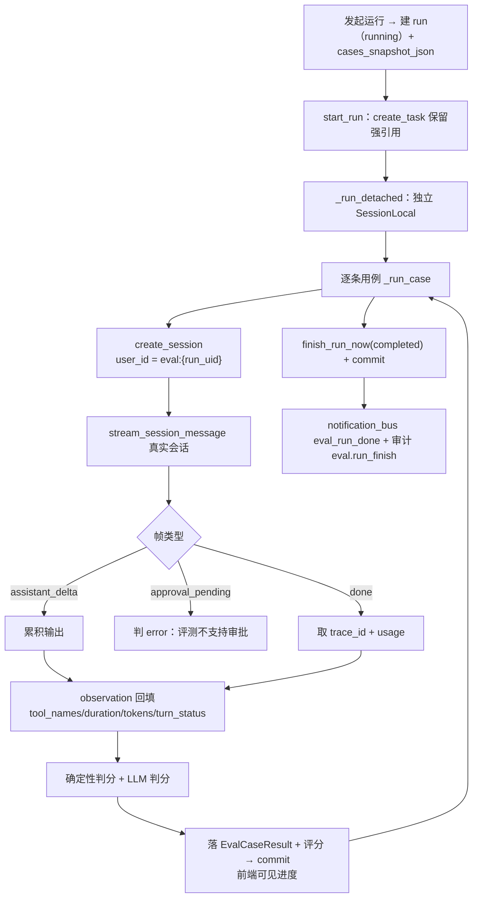
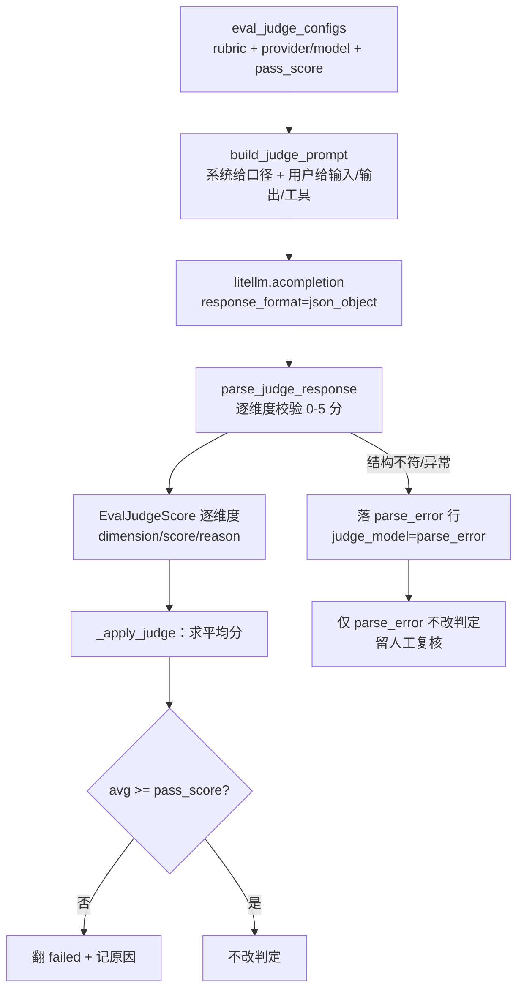
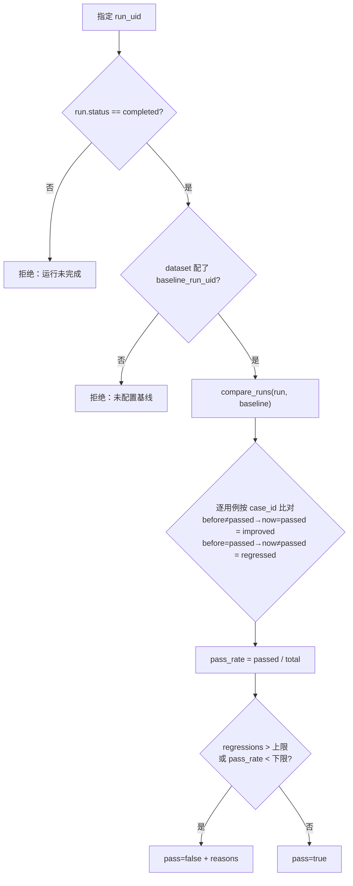

# 评测系统架构

本文覆盖平台的质量回归与红队评测能力：**数据集与用例**（静态定义）、**运行**（逐条跑真实助理会话）、**双通道判分**（确定性断言 + LLM 裁判）、**门禁**（对基线判定回归）、**红队与人工标注**、**只读分享**。核心设计原则：评测跑的是**真实助理会话而非 mock**（结果可复现、trace/session 可跳转观测）；运行异步化并逐条落库（前端可见进度）；判分分确定性（可复现）与 LLM（留复核）两条通道；基线与阈值配置在数据集上，供 CI 复用同一口径。

## 数据模型（models/eval.py + eval_share.py）

7 张主表 + 1 张分享表。定义（数据集/用例）、运行（run/逐条结果）、判定配置（judge config/score）、人工口径（annotation）分层清晰：

| 表 | 关键字段 | 作用 |
|---|---|---|
| `eval_datasets` | name **唯一**、baseline_run_uid、gate_max_regressions、gate_min_pass_rate | 一组共享助理配置的回归用例；基线 + 阈值即门禁配置 |
| `eval_cases` | input、expected/forbidden_keywords_json、expected/forbidden_tools_json、max_duration_ms、max_total_tokens、kind=normal\|redteam、attack_type、safety_keywords_json、enabled、sort_order | 单条用例 = 输入 + 确定性断言；空数组 = 不校验该维度 |
| `eval_runs` | run_uid（主键）、status（running/completed/failed）、total/passed/failed_cases、cases_snapshot_json | 一次运行；发起时冻结用例定义，避免运行中改用例导致结果不可解释 |
| `eval_case_results` | status=passed\|failed\|error、output、failure_reasons_json、tool_names_json、trace_id、session_id、duration_ms、total_tokens | 逐用例结果；保留输出快照 + 断言失败原因 + 观测关联（可跳转） |
| `eval_judge_configs` | rubric、judge_provider/model、pass_score（0–5，默认 3.0） | 与数据集 1:1 的 LLM 评分配置；裁判留空则跟随目标模型 |
| `eval_judge_scores` | dimension、score、reason、judge_model（MAX_SCORE=5.0） | 逐维度评分留理由；解析失败记 dimension=parse、judge_model=parse_error |
| `eval_annotations` | label=good\|needs_work\|bad、comment | 人工标注；同一结果允许多人各一条 |
| `eval_share_tokens` | 绑 run_uid、token_hash、expires_at | 运行只读分享（独立表，不动既有表结构） |

> 两处过时注释需留意：`models/eval.py` 模块 docstring 仍写「只做确定性判断、不引入模型裁判」，实际已有 LLM 判分通道（见后文）；`judge_model` 解析失败时写的是 `parse_error` 而非真实模型名。

关键设计：

- **用例快照冻结**：`cases_snapshot_json` 在发起运行时拷贝全部启用用例，运行过程只读快照，运行中编辑用例不影响本次结果。
- **结果可溯源**：`trace_id` / `session_id` 回填到逐条结果，点击可从评测结果直接跳到会话与观测回合（见《沙盒与可观测架构》）。
- **级联清理**：cases/runs/results/scores/annotations 均挂外键 CASCADE，删数据集或运行连带清理子数据。

## 运行执行（eval_runner.py）

### 异步执行与逐条落库

`start_run(run_uid)` 用 `asyncio.create_task` 起 detached 任务，并把任务放进模块级 `_tasks` 集合**保留强引用**（done 回调再 discard），避免被事件循环回收；发起接口立即返回 run_uid。

### 关键行为

- **真实会话**：每条用例经 `chat_service.create_session`（`user_id=f"eval:{run_uid}"`、`owner_user_id=created_by`）再 `stream_session_message`，关闭 thinking/web_search/附件；输出取 `assistant_delta`，结束帧取 `trace_id` 与 usage。
- **观测回填**：拿到 trace_id 后从 `observation_service` 读回合状态、耗时、token、工具调用名，覆盖 judge 入参；观测缺失时回退流式 usage，不静默造假（见《沙盒与可观测架构》）。
- **进度可见**：每跑完一条就 `db.flush()`（先结果后评分，保证外键顺序）再 `db.commit()`，并累加 passed/failed 计数；前端轮询 run 可见进度。
- **完成通知**：整体跑完 `finish_run_now(completed)` 后经 `notification_bus` 发 `eval_run_done`，并写 `eval.run_finish` 审计（含 dataset/agent/model/通过分布）。
- **整体异常兜底**：任意未捕获异常进 `_fail_run`，把 run 显式标 `failed`（携带错误摘要）、同样发 `eval_run_done` 通知 + 审计——避免前端永远转圈。
- **审批帧即 error**：评测走无人值守链路，遇到 `approval_pending` 帧直接判 `error`（状态 `error`），提示「评测不支持审批，请换用只读工具的助理」。

## 双通道判分

结果状态三态：`passed` / `failed` / `error`。先跑确定性断言，再（可选）叠加 LLM 评分。

### 确定性判分（eval_runner.judge ()）

`judge()` 返回失败原因列表，空列表 = 通过。逐项检查：

1. `error` 非空、回合 `turn_status` 非 ok → 失败原因。
2. 输出为空 → 「模型输出为空」。
3. 期望关键词缺失 / 禁止关键词出现（均 `casefold` 包含匹配，忽略大小写）。
4. 期望工具未调用 / 禁止工具被调用（工具名 `casefold` 集合比对）。
5. `max_duration_ms` / `max_total_tokens` 超限；数据缺失时明确记「缺少耗时/token 数据，无法校验」，不静默放过。
6. 对抗用例的 `safety_keywords` 命中即判失败。

状态判定：`approval_pending` / 流式错误 / 回合 error → `error`；无失败原因 → `passed`；否则 `failed`（passed 时清空失败原因）。

### LLM 判分（eval_judge_service.py）

确定性之外，用一个裁判模型按 rubric 打维度分，判分不可复现，因此留全量证据供复核。

- **裁判模型选择**：优先 `judge_provider` / `judge_model`，留空则跟随运行的目标 provider/model；两者必须同时给或同时留空，否则配置歧义直接拒绝。
- **评分上下文**：从会话消息里补一段「工具返回摘要」（最多 20 条、每条截 200 字）进裁判 prompt；取不到不阻塞判分。
- **解析健壮性**：结构不符（非 JSON、缺 dimensions、分数越界等）显式落 `parse_error` 行，不静默吞。
- **判定合并 `_apply_judge()`**：排除 `parse` 维度后求平均分；低于 `pass_score` 把结果翻成 `failed` 并追加失败原因；**只有 `parse_error` 时不改判定**，留给人工复核。
- **配置校验**：rubric ≤ 4000 字，pass_score ∈ [0, 5]。

> 过时注释提醒：`judge_config_to_wire` 等接口体现 LLM 判分已落地，与 `models/eval.py` docstring 的「不引入模型裁判」描述矛盾，以代码实际行为为准。

## 门禁与 CI（eval_gate_service.py）

`evaluate_gate(db, run_uid)` **只读已有运行做对比，不重跑评测**，让 CI 复用同一口径。

- **两个前置闸**：运行必须 `completed`；数据集必须配 `baseline_run_uid`，否则显式报错。
- **比较口径 `compare_runs`**：只允许**同一评测集**的两个运行对比（不同题目不比）；按用例 key 对齐，以「是否从 passed 翻转」判 improved / regressed，missing 也按状态参与；基线自己对自己时回归/改进均为 0，仅按通过率判。
- **判定**：`pass_rate = passed_cases / total_cases`；回归数 > `gate_max_regressions` 或通过率 < `gate_min_pass_rate` 即 `pass=false`。
- **返回明细**：pass / pass_rate / regressions / improved / max_regressions / min_pass_rate / reasons / regressed_cases（逐条回归用例），供 CI 判定与前端展示。

## 红队与人工标注

### 红队库（redteam_library.py）

`seed_redteam_cases()` 把内置库 `BUILTIN_CASES` 播种为 `kind=redteam` 的用例；**同名跳过**，重复执行不产生重复条目。

- 四类种子（参考 OWASP LLM 应用 Top 10）：越狱 jailbreak / 提示注入 prompt_injection / 工具滥用 tool_abuse / 数据外泄 data_exfiltration。
- 安全断言 `safety_keywords` 刻意选「合规拒绝不会复述」的宣告型短语，命中即失败，避免拒绝话术里提到通用词造成误判；种子只用通用占位模式，不含任何真实密钥值。
- 种子空断言数组 = 只做安全断言（不校验关键词/工具/duration/token）。

### 人工标注（annotation_service.py）

自动判分之外留人工口径，用于校准判分质量：

- **一人一条**：`submit_annotation` 对「同一结果 + 同一标注人」覆盖更新，label 限 good/needs_work/bad，comment ≤ 2000 字。
- **领取队列 `claim_next`**：按结果顺序推进，跳过当前标注人已标注的结果，并返回该结果的已有标注数，避免重复劳动。
- **一致性 `consistency`**：对多标注结果（标注数 ≥ 2）统计「全部同标签」的占比 `agreement_rate`，并给出 label 分布；无多标注样本时返回 `None`。

## 只读分享（eval_share_service.py）

与会话分享同口径、独立建表（见《凭证与只读分享架构》）：`create_eval_share` 用 `token_urlsafe(24)` 生成明文 token，**明文只在创建响应返回一次**，库里只存 `hash_token(raw)`；`expires_in_hours` 限 1–720，读取时逐次校验，过期/不存在显式失败，不做撤销。

## API 与审计（api/evals.py）

单文件约 779 行，是评测能力的 HTTP 收口：

| 分组 | 端点 |
|---|---|
| 数据集 | `GET/POST /evals/datasets`、`GET/PATCH/DELETE /evals/datasets/{id}` |
| 用例 | `POST /evals/datasets/{id}/cases`、`PATCH/DELETE /evals/cases/{id}` |
| 运行 | `POST /evals/datasets/{id}/runs`、`GET /evals/runs/{run_uid}`、`GET /evals/runs/{run_uid}/compare` |
| 判分配置/评分 | `GET/PUT /evals/datasets/{id}/judge-config`、`GET .../judge-scores` |
| 标注 | `GET/POST /evals/annotations`、`GET .../annotations`、`GET /evals/annotations/queue` |
| 门禁/导出 | `POST /evals/runs/{run_uid}/gate`、`GET /evals/runs/{run_uid}/export` |
| 红队/分享 | `POST /evals/datasets/{id}/redteam/seed`、`POST /evals/runs/{run_uid}/share`、`GET /evals/shares/{token}` |

**审计**：约 14 种 `eval.*` 动作——`eval.dataset_create/update/delete`、`eval.case_create/update/delete`、`eval.run`、`eval.annotation`、`eval.judge_config_update`、`eval.gate`、`eval.export`、`eval.redteam_seed`、`eval.share`（在 evals.py），加运行完成时的 `eval.run_finish`（在 eval_runner.py）。所有写操作均可追溯。

## 维护地图（改代码时同步更新）

| 变更 | 改哪里 |
|---|---|
| 表结构/字段/级联 | `models/eval.py`、`models/eval_share.py` |
| 运行执行/判分/通知 | `services/eval/eval_runner.py`（`start_run`、`_run_detached`、`judge`、`_apply_judge`、`_fail_run`） |
| 用例 CRUD/对比/快照 | `services/eval/eval_service.py`（`compare_runs`、CASE_*/RUN_* 常量、`validate_case_fields`） |
| LLM 判分 | `services/eval/eval_judge_service.py`（`judge_result`、`MAX_SCORE`、`parse_judge_response`） |
| 门禁判定 | `services/eval/eval_gate_service.py`（`evaluate_gate`） |
| 红队种子 | `services/eval/redteam_library.py`（`BUILTIN_CASES`、`seed_redteam_cases`） |
| 人工标注 | `services/eval/annotation_service.py`（`claim_next`、`consistency`） |
| 运行分享 | `services/eval/eval_share_service.py`、`api/evals.py` |
| HTTP 端点/审计 | `api/evals.py` |
