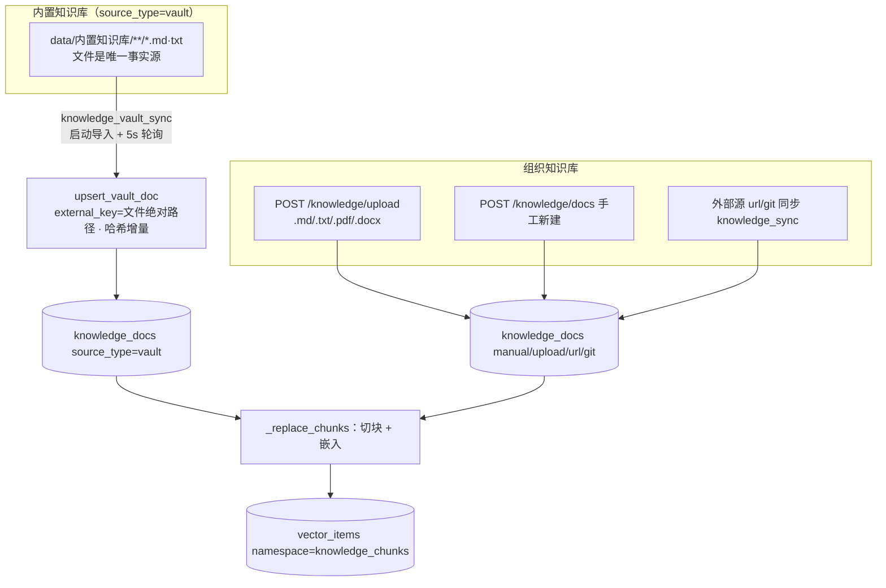
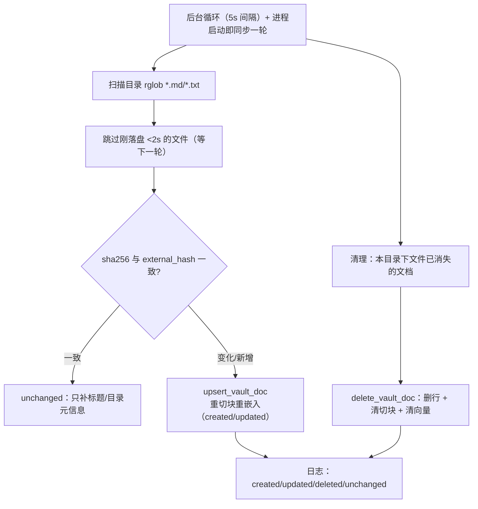
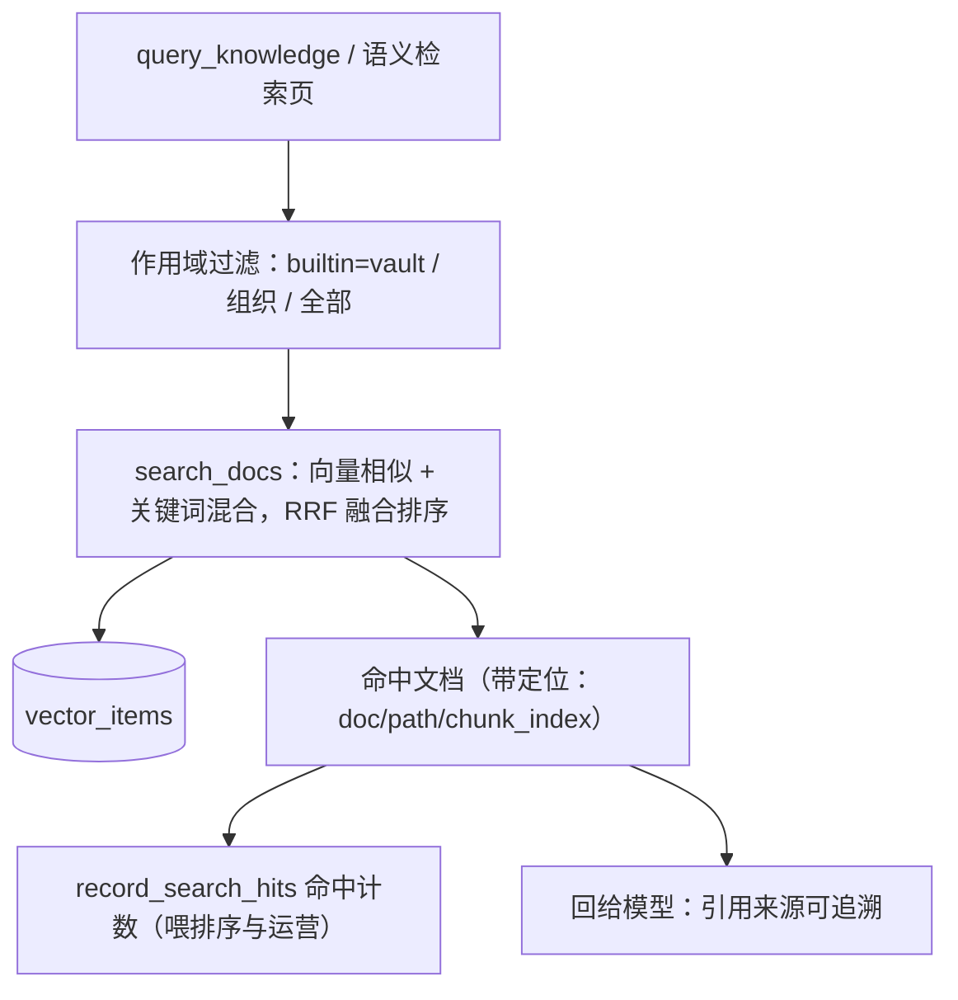

# 检索与知识架构

知识库分两个作用域：**内置（vault）**——文件即事实源、自动同步、应用内只读；**组织**——上传/手工/外部源入库、应用内可编辑。检索、记忆、MCP 工具索引共用同一套「切块 → 嵌入 → 向量库」管线。

## 双作用域与入库通道

## 内置知识库文件同步（services/knowledge/knowledge_vault_sync.py）

要点：

- 文档身份 = 语料文件绝对路径（external_key），据此圈定归属：只同步、只清理本目录下的文档，多目录/测试互不干扰。
- 标题取正文首个一级标题（无则文件名）；目录归属取文件相对路径的父目录（前端按段本地化，如 diagnostics/dns → 诊断 playbook/DNS）。
- 应用内 vault 文档只读（编辑/移动/删除均拒绝）：改动请改文件，秒级自动生效。
- 检索开关（enabled）保留用户设置：同步只动内容，不重置启停。

## 检索链路

- 切块参数（大小/重叠）存系统设置，reindex 可按当前配置全量重建。
- 向量库可切换实现（sqlite / pgvector / none）；none 时向量操作显式失败，不假装可用。

## 记忆与工具索引

| namespace | 来源 | 说明 |
|---|---|---|
| knowledge_chunks | 知识文档切块 | 上文两作用域共用 |
| memory_items | remember_memory / recall_memory | 跨会话记忆，助理级 + 全局 |
| mcp_tools | MCP 工具语义索引 | 配置衍生物，随 MCP 配置重建 |

## 维护地图（改代码时同步更新）

| 变更 | 改哪里 |
|---|---|
| 同步行为/间隔 | services/knowledge/knowledge_vault_sync.py + tests/test_knowledge_vault_sync.py |
| 切块/嵌入管线 | services/knowledge/knowledge_service._replace_chunks |
| 作用域/检索口径 | knowledge_service._source_condition / search_docs + tests/test_knowledge_scope.py |
| 语料内容 | 直接改 data/内置知识库/ 文件，秒级生效 |
